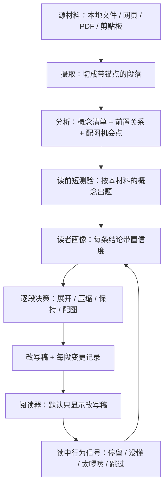

# 阅读文本自适应重写工具 · 设计

> 状态：**骨架已实现并端到端跑通（2026-10-05）**。§1–§9 的设计文字保持 2026-10-03 定稿原样，
> §10 记录 2026-10-05 的拍板与实现现状。实施契约（接口、目录、命令、验收）见
> [PLAN-skeleton.md](PLAN-skeleton.md)，命令与产物清单见 [README.md](README.md)。
> 决策方式：六轮问答逐项拍板，两条后台调研（自适应改写的学术方法 / 现有同类工具）提供依据，出处见 §9。
>
> **实现现状一句话**：本地文件入口 → 概念清单 → 最小画像 → 逐段决策 + 改写（只实现展开 / 保持）→
> 事实锚校验（数字 / 引号引文 / 书名号《》+ 段缺失）→ 阅读器三件套（改写稿 / 原文抽屉 / 讲解卡片）
> 这条链已用真模型跑通；严格档、压缩、配图、测验、行为回流都还是接口留位、未实现（§10.1）。

## 0. 一句话

一个本地网页阅读器：给它一段材料，它先问几个问题摸清你知道什么，再把材料改写成更贴合你的版本；读的时候原文收在右侧抽屉里（默认折叠），遇到不懂的点标记弹讲解卡片。

## 1. 目标与非目标

**目标**

1. **因人而异**：同一份材料，对不同读者（以及同一读者的不同时期）产出不同的改写稿。
2. **四个动作各自可控**：展开 / 压缩 / 保持 / 配图，不是一根「改写强度」旋钮。
3. **可追责**：每段都能说清「被做了什么、依据画像里的哪条结论」。
4. **原文永远在手边**：它是唯一的保真锚点。

**非目标（明确不做）**

- 多用户账号体系、协作与分享、移动端。
- 自研可读性评估算法、自研图表渲染（用现成组件，见 §9.3）。
- 逐句可回溯的改写（本次选择「自由重述」，见 §2.4）。
- 长书 / 整套材料的跨篇概念复用（列入第三期，见 §8）。

## 2. 关键设计决策

| # | 决策 | 选择 | 依据 | 已知代价 |
|---|---|---|---|---|
| 2.1 | 形态 | 本地网页应用：本机一个小服务 + 浏览器打开 | 三层对照、折叠展开、测验、图表都是浏览器最擅长的；改一次刷新即见 | 要管本地服务与端口；浏览器读不了任意磁盘路径，本地文件读取必须走服务端 |
| 2.2 | 改写时机 | 三层并存：读前整体改写 + 读中按需展开 + 原文对照 | 「缩写冗余」是对整篇的判断，只有读前做才成立；「展开难点」只有读者自己知道哪里难，读中做最准。硬塞进一个时机必然有一头做不好 | 架构最复杂；需要段落级稳定锚点（§4.5）；同一篇材料存在三份内容需保持一致 |
| 2.3 | 画像来源 | 短测验冷启动 + 读中行为持续修正，每条结论带置信度，可手动推翻 | 自评只反映「以为知道」；行为信号需要个人基线，冷启动没有基线，所以两者互补 | 要设计两路信号的合并规则；要防「一次误点把画像带偏」 |
| 2.4 | 保真红线 | **自由重述** + 事实锚底线（数字/年份/人名/书名/引文必须与原文一致） | 用户选择读起来最舒服的一档；但现成自动指标对数值改动完全不敏感，事实锚只能自建 | 失去「逐句可回溯」的自动证明；除事实锚外，保真只能靠人对照原文 |
| 2.5 | 阅读布局 | 默认只显示改写版；原文右侧抽屉、默认折叠、跟随当前段；**读中按需展开的产出也走弹出卡片**（可「钉住」到段落后方，默认不钉） | 用户裁定。主栏宽度保持舒适，正文不会被展开内容顶长 | 讲解与它对应的原句在视觉上分离，不像就地插入那样挨着 |
| 2.6 | 输入 | 可插拔摄取层：本地文件 / 网页 / PDF / 剪贴板；先实现本地文件 | 各入口互相独立，可分批做 | 四种入口的清理难度差异大（网页要去导航广告、PDF 要处理分栏与公式） |
| 2.7 | 服务对象 | 先自用，但画像格式、存储、接口按「任何读者都能用」设计 | 实现先只服务一个人，以后想给别人用不必推翻 | 多一层抽象；单用户场景下这些抽象暂时不产生收益 |

## 3. 架构

### 3.1 模块与接口

每个模块职责单一，只通过下列接口通信；接口的输入输出都是可落盘的文件形态，因此任一模块都能单独重跑。

| 模块 | 职责 | 接口 | 产物 |
|---|---|---|---|
| 摄取 Ingest | 各入口 → 统一的源文档 | `ingest(input) -> SourceDoc` | `source.md` + `source.meta.json` |
| 分析 Analyze | 抽概念清单、前置关系、配图机会点 | `analyze(SourceDoc) -> ConceptInventory` | `concepts.json` |
| 测验 Quiz | 按概念清单出题、收答案 | `buildQuiz(ConceptInventory, Profile) -> Quiz`<br>`applyAnswers(Quiz, answers) -> ProfileUpdate` | `quiz.json` + 作答记录 |
| 画像 Profile | 维护带置信度的读者模型 | `applySignals(Profile, [Signal]) -> ProfileUpdate` | `profile.yaml` |
| 重写 Rewrite | 逐段决策 + 生成改写稿 | `planDecisions(SourceDoc, ConceptInventory, Profile) -> [Decision]`<br>`rewrite(SourceDoc, [Decision], Profile) -> RewrittenDoc + Changes` | `rewritten.md` + `changes.json` |
| 阅读器 Reader | 展示三份内容、收集行为信号 | 读上述产物；写 `events.jsonl` | 行为事件流 |

**「概念清单」是测验与重写之间唯一的接口**：测验按它出题，重写按它决定哪里展开。两边互不知道对方的实现。

### 3.2 数据流



三条要点：

- **画像不是一次性产物**。行为回流更新画像后，只重跑受影响的段，不整篇重来。
- **每步产物都落盘**。中断了能接着跑；结果不对时能定位到是哪一步坏的（是概念清单错了、画像偏了，还是模型改坏了）。
- **同一个锚点贯穿全链**。改写稿的段、抽屉里的原文段、讲解卡片、行为事件都引用同一个段落 id。

### 3.3 计划的目录结构（本次不建）

```
adaptive-reader/
  DESIGN.md            ← 本文件（当前唯一内容）
  server/              ← 本地服务：摄取、分析、测验、画像、重写
  web/                 ← 阅读器前端
  profiles/            ← 读者画像（按读者分目录，先只有一个人）
  docs/                ← 调研存档、提示词版本记录
  samples/             ← 端到端样例材料
  tests/               ← 单元、契约、负向对照
```

## 4. 数据模型

### 4.1 源文档 `source.md` + `source.meta.json`

原始文本原样保留、只读；元数据是段落表。

```json
{
  "source_id": "capital-v1-ch01",
  "ingest": { "kind": "local_file", "path": "...", "hash": "sha256:...", "at": "..." },
  "paragraphs": [
    { "id": "p012", "index": 12, "text": "...", "text_hash": "ab12cd34" }
  ]
}
```

### 4.2 概念清单 `concepts.json`

```json
{
  "concepts": [
    {
      "id": "c07",
      "name": "社会必要劳动时间",
      "surface": ["社会必要劳动时间", "必要劳动时间"],
      "prereq": ["c01", "c03"],
      "difficulty_hint": 3,
      "paragraphs": ["p012", "p018"]
    }
  ],
  "illustration_candidates": [
    { "paragraph": "p034", "kind": "流程", "why": "三步递进，纯文字看不出先后" }
  ]
}
```

`kind` 取值限定为 `流程 / 结构 / 对比 / 数量`——只有这四类难点，图才真的比文字省力（§2 的配图动作据此触发）。

### 4.3 读者画像 `profile.yaml`

```yaml
reader: local-default
concepts:
  c07:
    state: partial          # known | partial | unknown
    confidence: 0.62        # 0–1，低于阈值时改写按"可能不知道"处理
    evidence:
      - { source: quiz,     at: "...", detail: "辨识题答对，复述题只答出一半" }
      - { source: behavior, at: "...", detail: "p012 停留偏短，未点没懂" }
preferences:
  - id: pref_paragraph_len
    statement: "偏好短段落"
    confidence: 0.40
    evidence: [{ source: behavior, detail: "长段停留久且频繁滚动回看" }]
overrides:                  # 用户手动推翻，优先级最高，行为信号不得覆盖
  - { concept: c01, state: known, at: "...", note: "别再解释了" }
```

### 4.4 改写稿与变更记录 `rewritten.md` + `changes.json`

```json
{
  "changes": [
    {
      "paragraph": "p012",
      "action": "expand",                 // expand | compress | keep | illustrate
      "why": { "profile": ["c07:partial"], "note": "该概念的前置 c03 未掌握" },
      "confidence": 0.78,
      "facts": { "numbers": ["1/2"], "quotes": ["..."] }
    }
  ],
  "fidelity": { "checked": true, "mismatches": [] }
}
```

`why.profile` 是追责的关键：出错时能分清是画像错了、概念清单错了，还是模型改坏了。

`fidelity.checked` 的写入时机（§6 的纪律）：`rewrite` 阶段写 `false`（逐段比对还没跑，
`counts` 留 `null`），只有 `ar check` 在**比对项 > 0 且没有任何不一致**之后才写 `true` + `counts`；
校验失败时 `checked` 保持 `false`，但 `mismatches` / `counts` 照样写回（跑过了、结果是坏的，要留痕）。

### 4.5 锚点规则（全系统的骨架）

- 段落 id 在摄取时生成并**持久化**，形如 `p012`；同时记 `text_hash` 用于校验。
- 改写、原文对照、讲解卡片、图表、行为事件一律引用段落 id，不引用位置或行号。
- 重新摄取同一份材料时，段落 id 必须与上次一致（同 hash 同序号），否则历史画像与行为事件会错位。这条有专门测试（§7）。

## 5. 阅读器交互规格

| 元素 | 默认状态 | 交互 |
|---|---|---|
| 改写稿主栏 | 显示 | 唯一常驻内容 |
| 原文抽屉 | **折叠**（右侧一条窄边） | 点开滑出，跟随当前段；再次点击收起 |
| 段落动作标记 | 常驻小标记 | 悬停显示「展开 / 压缩 / 保持 / 配图」与依据摘要 |
| 讲解卡片（预生成） | 不显示 | 点段落标记弹出：定义 / 举例 / 前置概念。随改写稿一起生成，所以是瞬时的；点外部关闭；**不改动正文** |
| 「没懂」标记（现场生成） | 不显示 | 点一下当场生成一段更简单或更详细的讲解，同样走卡片；可「钉住」到段落后方；信号写进行为流 |
| **选片讲解浮条**（2026-10-08 补） | 不显示 | 在主栏或原文抽屉里**选中文字**后浮在选区旁，三个按钮「没懂 / 再简单点 / 再详细点」→ 复用同一张讲解卡片。卡片标明这是**选中片段**、所属段号与片段预览；片段模式下隐藏整段口径的事实锚 chips，保留概念 chips。选区**归属看锚点（起点）落在哪一段**（跨段时也只按那一段讲，并写明跨了几段）；空 / 纯空白 / 1 个字符不出浮条，滚动、点空白、Esc 都收起 |
| 「太啰嗦」标记 | 不显示 | 同上，触发局部压缩 |
| **阅读显示设置**（2026-10-08 补） | 跟随系统深浅色 | topbar「Aa」按钮开面板：背景 3 档（纸白 / 暖黄 / 深色）× 文字 2 档（深墨 / 浅灰）× 正文字号 4 档（15/16/17/19px，只影响正文栏）；「恢复默认」清掉手动选择。手动选过之后以手动为准，落 `localStorage["ar.settings.v1"]`，**渲染前应用**（不闪白底）。颜色分**两条轴**：正文栏跟文字档，「浮在内容之上的面」（顶栏 / 徽标 / 抽屉 / 卡片 / 浮条 / 设置面板）跟背景档且底色与文字成对 ⇒ 深色档下面板也是深的、文字是浅的（2026-10-08 复核修：此前面板恒为白底，深色档下浅字落白底只有 1.2–1.6:1）。手动组合出读不清的正文（纸白 / 暖黄 + 浅灰、深色 + 深墨）时**不拦，但设置面板里出实测对比度告警** |
| 图表 | 就地插入 | 生成失败时退回文字说明（§6） |
| 读前测验 | 首次打开材料时 | 三类题分层：自评 → 辨识题 → 少量复述题；可整场跳过 |
| 压缩提示 | 读完时 | 显示「本次改写比原文短/长了多少」，不做干预。**2026-10-08 起改在「— 改写稿结束 —」之后的正文流内块**（不是底部浮窗），读完才出现 |

**三层与入口的对应**：层 1 原文（右侧抽屉）／层 2 整体改写版（主栏）／层 3 按需讲解（卡片）。层 3 有三个入口——点段落标记走**预生成**（快）；点「没懂」走**现场生成**（慢但更贴切）；选中一段文字走**片段讲解**（现场生成，粒度最细，请求带 `selection` / `selection_from`）。三者都只出卡片，都不改动主栏正文。同一段（或同一片段 + 同一 kind）在一次会话里只生成一次：会话内缓存 + 在飞去重，避免重复计费；缓存键里带**画像指纹**（与后端缓存键同口径，见 `src/ar/cache.py`），所以会话内改了画像（自评写回 / 手改 `overrides`）不会命中旧答案。卡片三段布局：头部（段号 / 动作）→ 内容滚动区 → **底部固定区**（缓存 / 截断标记 + 状态行 + 动作按钮），长答案下状态行不会被滚走。

**测验为什么分三层**：自评最便宜但只反映「以为知道」；辨识题能抓出「以为会其实不会」；复述题最准也最贵，所以只对前两层筛出「不确定」的概念使用。

## 6. 错误处理与降级

| 情况 | 行为 |
|---|---|
| 模型超时 / 不可用 | 已生成的部分照常能读；未生成的段落显示原文并标「未改写」，**整条链以退出码 6 结束**（`rewrite` 打印失败批次与受影响段 id，`check` 同码），产物里留 `meta.model_errors` |
| 模型没给出某段的决策 | 同上一行：该段退回原文、记 `meta.unplanned_paragraphs`，退出码 6（不许因为「别的段成功了」就算成功） |
| 概念清单抽取失败 | 降级为「无画像」模式（等同原文阅读），明确提示，不静默 |
| 测验题目本身看不懂 | 允许整场跳过，画像退化为纯行为信号 |
| 图表生成失败 | 退回文字说明，不留空白、不留破图 |
| 事实锚校验不过 | 该段标红，指出具体对不上的数字 / 引文；退出码 4 |
| 校验所需产物缺失 / 不可读 / 为空 | 非零退出（2）并点名缺哪一份（`changes.json` 没了、不是对象、`changes` 空数组等）；没得比不许报通过 |
| **检查器空跑（0 比对项）** | 空文档 / 段落表为空时**算失败**（措辞「检查器空跑」，退出码 4）；`fidelity.checked` 只在比对项 > 0 且无不一致时才为 `true` |
| 行为信号与画像冲突 | 需多次一致才改画像，且带时间衰减；用户手动 `overrides` 永不被覆盖 |
| 材料重新摄取导致段落 id 变化 | 拒绝合并历史画像，提示需重新校准 |

**一条纪律**：任何降级都必须可见。静默降级（看起来正常、实际没做）是本项目最容易出的事故类型——`学习/_整理/` 那套流程已经栽过两次「检查器失灵」。

**这条纪律的两个具体推论**（2026-10-05 对抗性复核后补写，都是实测出的漏网）：

1. **检查器空跑 = 失败**，不是「无问题」。一个什么都没比的检查器会给出最干净的报告
   （0 违例），所以「比对项为 0」必须自己变成一条违规：空文档、`paragraphs: []`、
   没有变更记录，都要非零退出并说明原因。「产物缺失」不是「没有坏消息」。
2. **退出码必须区分「没改坏」与「真的改了」**。事实锚只能证明前者：整批模型挂掉时，
   整篇保持原文，事实锚反而完美通过。所以「有段落没被改写」必须靠**退出码 6 + 产物字段
   （`model_errors` / `unplanned_paragraphs` / `degraded`）**暴露出来，而 `rewrite` 阶段
   不许预先写 `fidelity.checked: true`（那时比对还没跑）。

## 7. 测试与验收

> **2026-10-05 现状**：本节是定稿时写的验收标准，实施契约把它拆成了里程碑验收
> （PLAN-skeleton §5）。已落地的口径：事实锚校验覆盖 **数字 / 引号引文 / 书名号《》+ 段缺失**
> （人名与年份暂并入数字与引文两类，没有独立规则）；**理解力测验仍未做**，
> 所以「人工验收」那一条目前不成立——「读着舒服」仍然不等于「读懂了」。
> 其余各条见 §10.2。

**单元**

- 锚点稳定性：同一份源文档两次切分，段落 id 集合完全一致。
- 事实锚抽取与比对：数字、年份、人名、书名、引文的识别规则。
- 画像合并规则：阈值、衰减、`overrides` 优先级。

**负向对照（必做）**

往改写稿注入一处数字改动 → 事实锚检查必须报错；删一段 → 变更记录必须报缺；往画像注入矛盾信号 → 合并规则必须不改变结论。参照 `学习/_整理/selfcheck.py` 的做法（往临时副本注入缺陷，确认检查器仍会报警）。

**契约测试**

四种摄取入口产出同一形态的 `SourceDoc`（先只实现本地文件，其余入口按同一契约补齐）。

**端到端**

拿《资本论》第一卷第一章跑通：摄取 → 概念清单 → 短测验 → 逐段决策 → 改写稿 → 阅读器加载。

**人工验收（不能只看「读着舒服」）**

- 必须配一个理解力小测验：调研实测「主观觉得好读」与「真的读懂」相关系数不到 0.1。
- 抽查改写稿与原文的事实一致性（事实锚只能守住数字与引文）。

**回归基线**

固定模型与提示词版本；同一输入两次生成的差异要可度量（否则改一次提示词就说不清是变好还是变坏）。

## 8. 分期

| 期 | 内容 | 完成判据 |
|---|---|---|
| 第一期（能用的最小版本） | 本地文件入口 + 概念清单 + 读前短测验 + 四动作改写 + 阅读器三件套（改写版 / 原文抽屉 / 讲解卡片） | 能读完一篇材料，且每段都能说清被做了什么 |
| 第二期 | 行为信号回流（画像更新 + 局部重跑）、按需配图、网页与 PDF 入口 | 同一材料第二次读的画像比第一次准 |
| 第三期 | 长书 / 整套材料的跨篇概念复用 | 看第一期好不好用再定 |

## 9. 调研依据

### 9.1 结论（驱动了哪些决策）

| 结论 | 出处 | 影响了 |
|---|---|---|
| **没有任何现成方案覆盖「测读者 → 因人而异改写 → 按需配图」完整链路**。最接近的是 Google 的 Learn Your Way 研究原型（按选定年级重排 + 自动配图/时间线/思维导图），但读者侧只到自报年级与兴趣，且论文自述「not intended to be an educational product」 | [arXiv 2509.18664](https://arxiv.org/abs/2509.18664) | 项目可行性；§9.2 的差异化定位 |
| 中文语境下「同主题多难度改写」是空白：一个开源中文阅读平台的竞品调研文档把它列为 Tier 3「高成本缺口」 | [chinese-literacy-platform 调研文档](https://github.com/Youngger9765/chinese-literacy-platform)（二手） | 同上 |
| **对高熟悉度的读者，过度简化会掉信息、还会被跳过**（被跳过最多的是「研究局限」那类段落）；实验为三个组内设计，N=199/191/203 | [arXiv 2403.04979](https://arxiv.org/abs/2403.04979) | 决策 2.2 的「保持」动作；§2 四动作表 |
| **「展开」与「压缩」应是独立可控的动作**，不是一根强度旋钮；简化操作可分四类（elaboration / replacement / deletion / insertion），且用户指定位置的改法优于全局自动改 | [Med-EASi, arXiv 2302.09155](https://arxiv.org/abs/2302.09155) | 决策 2.2；§2 的四动作设计 |
| **「主观好读」与「真的读懂」不相关**（Likert 评分与理解力相关系数 ≤0.08）；个性化还会强化用户既有偏见并引入幻觉 | [ReLay, arXiv 2605.00468](https://arxiv.org/abs/2605.00468) | §7 的人工验收必须配理解力测验；§6 的可见降级纪律 |
| **数值改动对所有现成自动指标不可见**；没有任何单一指标能同时覆盖简化度、忠实度、信息量、连贯性 | [APPLS](https://ar5iv.labs.arxiv.org/html/2305.14341)、[PLABA](https://ar5iv.labs.arxiv.org/html/2507.14096) | 决策 2.4 的事实锚；§7 负向对照 |
| **读者建模应做成「带不确定性的信念 + 随交互更新」**，而非一次测准；行为信号需要个人基线，冷启动没有基线 | [SNAPE-PM, arXiv 2505.13053](https://ar5iv.labs.arxiv.org/html/2505.13053) | 决策 2.3；§4.3 的 confidence 字段 |
| 自评只反映「以为知道」；测验题成本高（要先有一份细粒度知识点清单）；术语识别本身很难 | 同上；[QueryQuilt](https://ar5iv.labs.arxiv.org/html/2512.22404)、[PLABA](https://ar5iv.labs.arxiv.org/html/2507.14096) | §5 的三层测验设计 |
| 中文没有「每分钟正确词数」的等价难度量尺，词界靠读者自行切分 | chinese-literacy-platform 调研文档（二手） | §10 的风险项；难度估计只作辅助信号 |
| 最接近本设想的开源中文实现是一个小学课文简化项目（Llama-3.1-8B + LoRA，按句长上限与 HSK 词表分三档），无读者测评、无图表 | [chinese-text-simplification](https://github.com/willy40567/chinese-text-simplification) | 差异化定位 |
| 覆盖中文的自适应简化研究存在，但无读者个体模型、无图表 | [Re-RIGHT, ACL 2026](https://aclanthology.org/2026.acl-long.1086/) | 同上 |

### 9.2 本项目的原创空间

1. **读前测读者的领域知识**——现有产品几乎都靠老师选级别或读者自报年级。
2. **「这段该展开还是该压缩」的取舍决策**——可借用 ReLay 的 Knowledge Alignment 指标做评测。
3. **因为「这里难懂」而配图**——现有产品要么不配图，要么套固定模板。

### 9.3 可直接复用的组件（不自研）

| 用途 | 候选 |
|---|---|
| 中文可读性评估 | [python-readability-cn](https://github.com/chenryn/python-readability-cn)、[HSK-Character-Profiler](https://github.com/Ancastal/HSK-Character-Profiler)、[CTRDG + MLF-BERT](https://github.com/CocoTan1020/CTRDG)（HSK 一至六级，5721 篇） |
| 难度分级标准 | HSK 一至六级、CEFR、[《8—12岁儿童分级阅读指导》团体标准](https://edu.cctv.com/2025/04/24/ARTIes6OSgGx2DtckAoLypSc250424.shtml) |
| 中文简化数据集（做回归基线） | [MCTS](https://github.com/blcuicall/mcts)（首个公开中文简化数据集，723 句）、CSSWiki、CTRDG |
| 图表生成 | [mermaid](https://github.com/mermaid-js/mermaid)（带语法校验的封装：[mcp-mermaid](https://github.com/hustcc/mcp-mermaid)）、[antvis/mcp-server-chart](https://github.com/antvis/mcp-server-chart)（25+ 图表）、[Napkin AI API](https://www.napkin.ai/api/)（商业，出 SVG） |
| 概念与前置关系 | [Atlas of Knowledge](https://github.com/theworker02/atlas-of-knowledge)（含显式前置边）、[术语在线 MCP](https://lobehub.com/mcp/aschenmo-termonline-mcp)、ConceptNet 中文部分 |
| 知识追踪（第二期以后参考） | [pyKT](https://github.com/pykt-team/pykt-toolkit)、[EduKTM](https://github.com/bigdata-ustc/EduKTM) |

## 10. 2026-10-05 拍板与现状

### 10.1 用户拍板（六问的答案 → 落地方式）

| # | 事项 | 拍板结论 | 落地方式（实现处） |
|---|---|---|---|
| 1 | 「严格档」（逐句可回溯规格） | **一期不做，但接口预留** | 重写引擎按 `mode` 留插口，默认 `free`；`ar rewrite --mode strict` 明确报错 + 退出码 3，**不写产物、不发请求**（`src/ar/rewrite.py::STRICT_NOT_IMPLEMENTED`） |
| 2 | 图表方案 | 方向定为 **mermaid + SVG**（结构 / 流程类走 mermaid，需要精确排版或自定义图形时走 SVG） | 骨架不做配图；本机已有离线 mermaid 构建（`deepseek-chat/app/js/vendor/mermaid.min.js`），二期直接搬，不引 CDN |
| 3 | 范围 | **先做走通骨架**，链路验证过再补齐 | 见 PLAN-skeleton §2；骨架已跑通，压缩 / 配图 / 测验 / 行为回流 / 网页入口留待下一批 |
| 4 | 模型接入 | **OpenAI 兼容 HTTP + 项目内配置**，密钥不进任何被提交的文件 | `src/ar/model.py` + `config.local.json`（密钥优先取环境变量 `AR_API_KEY`，只在运行时读；报错与产物全部脱敏） |
| 5 | 画像 | **YAML**，落 `profiles/<读者 id>/profile.yaml`（便于手改 `overrides`） | `src/ar/profile.py`（`overrides` 优先级最高，写入时追记） |
| 6 | 压缩提示 | **只在读完时提示**，读中不常驻 | 前端 `web/js/main.js` 的 `markReadComplete()`（滚到底才显示「本次改写比原文长 / 短了百分之几」） |
| 7 | 概念清单复用 | **一期按单篇独立**，字段预留跨材料合并 | `concepts[].domain` / `concept_key` 已落库（如 `socially_necessary_labor_time`），合并逻辑不做 |
| 8 | 项目命名 | **沿用目录名 `adaptive-reader`** | `pyproject.toml` 的包名与 console script `ar` |

多出来的第 9 条（实现时定的，回填进本表）：**事实锚按段、按数量与顺序严格比对**，
含书名号《》与段缺失检查；报出违规时**必须人工看一眼原文**——知道会有假阳性（见 §10.3）。

### 10.2 现在能做什么、不能做什么

| 能力 | 状态 |
|---|---|
| 本地文件摄取 + 稳定锚点（同文件重复摄取 id / text_hash 一致） | ✅ |
| 概念清单抽取 + 契约校验（`kind` 只四类、段 id 必须存在） | ✅ 真机 12 条概念 / 4 个配图候选 |
| 最小画像（手写 YAML + 页面自评勾选写回） | ✅（当前 `local-default` 是空画像，产物里显式标注「无画像」） |
| 逐段决策 + 改写（**只实现展开 / 保持**） | ✅ 真机 25 段：展开 8 / 保持 17 |
| 压缩 / 配图 | ⛔ 枚举位已留，遇到按保持处理并标 `deferred`（页面显示「骨架未实现该动作」） |
| 事实锚校验（数字 / 引号引文 / 书名号 + 段缺失） | ✅ 真机 34 数字 + 11 引文 + 13 书名全部通过，`check` 退出码 0 |
| 阅读器三件套（改写稿主栏 / 原文抽屉 / 讲解卡片） | ✅ 真服务 + 本机 Edge 联调通过，`/api/explain` 三种 kind 真机成功 |
| 严格档 / 读前测验 / 行为回流 / 局部重跑 / 配图 / 网页 PDF 入口 / 跨材料复用 | ⛔ 未实现 |

### 10.3 风险（按实现后的新证据更新）

| 风险 | 说明 | 缓解 |
|---|---|---|
| 保真只能半自动 | 自由重述 + 无逐句校验，事实锚只覆盖数字 / 引文 / 书名 | 抽屉里的原文随时可对照；**真机第一轮就抓到一条**（展开段把同一句引文引了两次，`check` 点名 `p021`），收紧提示词后通过 |
| 事实锚有假阳性 | 按段 + 按数量与顺序比对：把事实挪到别的段落、重复引用、顺序调换都会报违规 | 报出来先人工看一眼；宁可多报也不放过（检查器失灵是本项目最容易出的事故） |
| 冷启动画像不准 | `local-default` 现在是空画像，决策只能依据概念难度提示 | 产物里显式写 `profile_used: false` + 每段依据标注；要让改写真的「因人而异」得先攒画像 |
| 展开段会变长，不是变短 | 真机 25 段：原文 5,210 字 → 改写 6,202 字（长 19%） | 这是「展开」的预期结果；压缩动作未实现，所以目前只有「变长」这一侧 |
| 成本不可预估 | 读中按需展开是按点击付费 | 骨架的整篇改写成本可估（本例 4.5 万 token / 10 次调用）；读中展开每次 12–46 秒、单次 1 个请求 |
| 中文难度量尺不成熟 | 没有 WCPM 等价物 | `difficulty_hint` 只当辅助信号，不作验收标准 |
| 主观与真实理解脱节 | 「读着舒服」不等于「读懂了」 | 本骨架**没有**理解力测验兜底，README §8 已写明这条限制 |

### 10.4 下一批的落点（本骨架明确没做的）

1. 压缩动作与配图动作（含 mermaid / SVG 渲染与失败退回文字）；
2. 读前短测验（自评 → 辨识 → 复述三层）与画像合并规则（阈值、衰减、`overrides` 优先）；
3. 行为信号回流（`events.jsonl`）与「只重跑受影响的段」；
4. 网页 / PDF / 剪贴板入口（同一 `SourceDoc` 契约）；
5. 规模压力样例（`学习/原文/01-资本论第一卷_第1章_商品.md`，199 段）与成本实测。

## 11. 与工作区既有资产的关系

- `学习/_整理/`（《资本论》B 级改写的工具链与质检脚本）：**不改动**。本项目参考了它的质检思路
  （`selfcheck.py` 的「临时副本注入 + 注入生效断言」负向对照、`spec_check.py` 的数字多重集口径），
  并已在第一期用它的材料（`学习/_第1章第1节三版对照/00-底本.md`）跑通端到端。
- 工作区根 `AGENTS.md` 是目录索引，尚未登记本目录；要不要加一行由用户决定。
