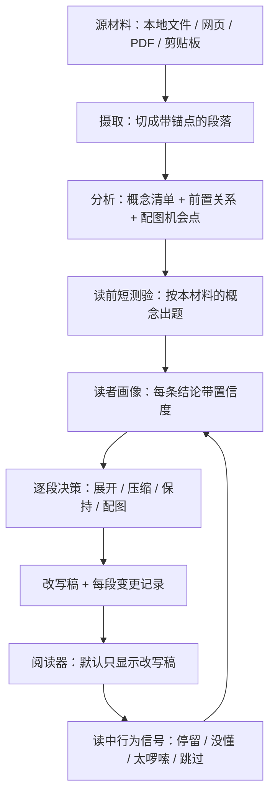

# 阅读文本自适应重写工具 · 设计

> 状态：**骨架已实现并端到端跑通（2026-10-05）**。§1–§9 的设计文字保持 2026-10-03 定稿原样，
> §10 记录 2026-10-05 的拍板与实现现状（2026-10-08 追加「读前背景问卷」一层的现状标注）。
> 实施契约（接口、目录、命令、验收）见
> [PLAN-skeleton.md](PLAN-skeleton.md)，命令与产物清单见 [README.md](README.md)。
> 决策方式：六轮问答逐项拍板，两条后台调研（自适应改写的学术方法 / 现有同类工具）提供依据，出处见 §9。
>
> **实现现状一句话**：本地文件入口 → 概念清单 → 最小画像 + **读前背景问卷** →
> 逐段决策 + 改写（**四动作全部实现**：展开 / 压缩 / 保持 / 配图）→
> 事实锚校验（数字 / 引号引文 / 书名号《》+ 段缺失）→ 阅读器三件套（改写稿 / 原文抽屉 / 讲解卡片）
> 这条链已用真模型跑通（**其中展开 / 保持那一支有真机记录**）；第四批（2026-10-13）把
> **压缩、配图、行为回流、局部重跑**四项从「接口留位」推进到「逻辑已实现」，
> 但**只有假模型 + 夹具覆盖、真机未跑**（本批硬约束是零真实模型调用，见 §10.2 / §10.4 第 7 项）。
> 仍是接口留位、未实现的是：**严格档、按材料出题的测验、网页 / PDF 入口、跨材料复用**（§10.1/§10.4）。
> **读前背景问卷那一层已真机验收通过**（2026-10-13：`rewrite-v3` 带读者素描整篇跑两遍，
> 第 1 遍产物坏、丢掉重跑且**没有放宽校验**，第 2 遍全绿）；两遍实测的产物核对与 token 账见
> [README.md](README.md) §2.1.1。**尚未做的是它的效果观测**（见 §10.4 第 6 项）。

## 0. 一句话

一个本地网页阅读器：给它一段材料，它先问几个问题摸清你知道什么（**跨材料的背景问卷**：学历 / 高中六选三 / 大学学科门类 / 自报熟悉领域 / 常读材料 / 偏好讲法，可整场跳过，答完还能让模型追问几个细节），再把材料改写成更贴合你的版本；读的时候原文收在右侧抽屉里（默认折叠），遇到不懂的点标记弹讲解卡片。

## 1. 目标与非目标

**目标**

1. **因人而异**：同一份材料，对不同读者（以及同一读者的不同时期）产出不同的改写稿。
2. **四个动作各自可控**：展开 / 压缩 / 保持 / 配图，不是一根「改写强度」旋钮。
3. **可追责**：每段都能说清「被做了什么、依据画像里的哪条结论」。
4. **原文永远在手边**：它是唯一的保真锚点。

**非目标（明确不做）**

- 多用户账号体系、协作与分享、移动端。
- 自研可读性评估算法、自研图表渲染（用现成组件，见 §9.3）。
- 逐句可回溯的改写（本次选择「自由重述」，见 §2.4）。
- 长书 / 整套材料的跨篇概念复用（列入第三期，见 §8）。

## 2. 关键设计决策

| # | 决策 | 选择 | 依据 | 已知代价 |
|---|---|---|---|---|
| 2.1 | 形态 | 本地网页应用：本机一个小服务 + 浏览器打开 | 三层对照、折叠展开、测验、图表都是浏览器最擅长的；改一次刷新即见 | 要管本地服务与端口；浏览器读不了任意磁盘路径，本地文件读取必须走服务端 |
| 2.2 | 改写时机 | 三层并存：读前整体改写 + 读中按需展开 + 原文对照 | 「缩写冗余」是对整篇的判断，只有读前做才成立；「展开难点」只有读者自己知道哪里难，读中做最准。硬塞进一个时机必然有一头做不好 | 架构最复杂；需要段落级稳定锚点（§4.5）；同一篇材料存在三份内容需保持一致 |
| 2.3 | 画像来源 | 短测验冷启动 + 读中行为持续修正，每条结论带置信度，可手动推翻 | 自评只反映「以为知道」；行为信号需要个人基线，冷启动没有基线，所以两者互补 | 要设计两路信号的合并规则；要防「一次误点把画像带偏」 |
| 2.4 | 保真红线 | **自由重述** + 事实锚底线（数字/年份/人名/书名/引文必须与原文一致） | 用户选择读起来最舒服的一档；但现成自动指标对数值改动完全不敏感，事实锚只能自建 | 失去「逐句可回溯」的自动证明；除事实锚外，保真只能靠人对照原文 |
| 2.5 | 阅读布局 | 默认只显示改写版；原文右侧抽屉、默认折叠、跟随当前段；**读中按需展开的产出也走弹出卡片**（可「钉住」到段落后方，默认不钉） | 用户裁定。主栏宽度保持舒适，正文不会被展开内容顶长 | 讲解与它对应的原句在视觉上分离，不像就地插入那样挨着 |
| 2.6 | 输入 | 可插拔摄取层：本地文件 / 网页 / PDF / 剪贴板；先实现本地文件 | 各入口互相独立，可分批做 | 四种入口的清理难度差异大（网页要去导航广告、PDF 要处理分栏与公式） |
| 2.7 | 服务对象 | 先自用，但画像格式、存储、接口按「任何读者都能用」设计 | 实现先只服务一个人，以后想给别人用不必推翻 | 多一层抽象；单用户场景下这些抽象暂时不产生收益 |

## 3. 架构

### 3.1 模块与接口

每个模块职责单一，只通过下列接口通信；接口的输入输出都是可落盘的文件形态，因此任一模块都能单独重跑。

| 模块 | 职责 | 接口 | 产物 |
|---|---|---|---|
| 摄取 Ingest | 各入口 → 统一的源文档 | `ingest(input) -> SourceDoc` | `source.md` + `source.meta.json` |
| 分析 Analyze | 抽概念清单、前置关系、配图机会点 | `analyze(SourceDoc) -> ConceptInventory` | `concepts.json` |
| 测验 Quiz | 出题、收答案 | **本层（2026-10-08 已实现）**：跨材料背景问卷，与材料无关<br>`surveyQuestions() -> [Question]`<br>`validateAnswers(answers) -> Background`<br>`renderSketch(Background) -> str`（读者素描）<br>**下一层（未实现）**：按本篇材料的概念清单出题<br>`buildQuiz(ConceptInventory, Profile) -> Quiz`<br>`applyAnswers(Quiz, answers) -> ProfileUpdate` | `profiles/<reader>/profile.yaml` 的 `background` 块 + `profiles/<reader>/survey.json`<br>（下一层留 `quiz.json`） |
| 画像 Profile | 维护带置信度的读者模型 | `applySignals(Profile, [Signal]) -> ProfileUpdate`<br>`set_preference(Profile, id, value) -> Profile`（显式偏好设置，**新偏好的唯一创建路径**） | `profile.yaml` |
| 重写 Rewrite | 逐段决策 + 生成改写稿；**`why.profile` 逐条保留模型给的引用**（漏键 / 给错形状 / 该给引用却给空数组 ⇒ 逐段可见降级 + 只照读者自评兜底补齐，读者本来没有自评时不误报，契约 §4.4） | `planDecisions(SourceDoc, ConceptInventory, Profile) -> [Decision]`<br>`rewrite(SourceDoc, [Decision], Profile) -> RewrittenDoc + Changes` | `rewritten.md` + `changes.json` |
| 事实锚 Fidelity（2026-10-14 扩） | 三类锚点抽取 + **按口径**逐段比对：申报（`fact_declarations`）覆盖的缺失在松口径下放行、其余一律违规；**申报与实测对不上**（多申报）单列一条可见说明、不改结论 | `facts_of(text)` / `parse_declarations(raw)` / `compare_blocks_detailed(src, blocks, declarations=…, policy=…) -> FactComparison`（`compare_blocks` 的三返回值签名不变） | 无（结果写回 `changes.json` 的 `fidelity.{fact_anchor_policy,waived,over_declared,mismatches,counts}`） |
| 模型调用 LLM（2026-10-13 新增） | 全仓模型调用的唯一出口：重试策略、错误码白名单、逐次尝试记账；**失败不抛** | `call(LlmRequest, client, policy) -> LlmResult`<br>`acall(...)`（异步同形） | 无（账目落进各业务产物的 `meta.attempts` / `meta.retry_account`，见 §4.6） |
| 工具 Tools（2026-10-13 新增，第四批加第五个） | 五个能力各是一个**具名工具**：拼提示词 → 经 LLM 层调模型 → 解析成结构 | `analyze_concepts` / `rewrite_batch` / `explain_paragraph` / `survey_followups` / `compress_paragraph`（入参出参均是 JSON Schema，`ar tools` 可列举） | 无（**校验与落盘仍留在原模块**：`validate_inventory` 之类不搬） |
| 行为事件 Events（2026-10-13 第四批新增） | 行为事件流的读写与折算：一行一条 JSON、按 `id` 幂等去重、`kind` 白名单、事件 → 画像信号；另有回流**水位线**（已折算的事件 id，供 `ar feedback --apply` 幂等） | `read_events` / `append_events` / `validate_event` / `dedup` / `signals_from_events` / `read_feedback_record` / `pending_events` / `write_feedback_record` | `profiles/<reader>/events.jsonl`（**只 append**；端点与 CLI 都不写 `profile.yaml`）+ `profiles/<reader>/feedback.json`（水位线，不进版本库、不参与画像指纹，见 §10.2） |
| 阅读器 Reader | 展示三份内容、收集行为信号 | 读上述产物；写 `events.jsonl` | 行为事件流 |

**「概念清单」是测验与重写之间唯一的接口**：测验按它出题，重写按它决定哪里展开。两边互不知道对方的实现。

**背景问卷是这条线上的例外**（2026-10-08）：它是**跨材料**的固定问卷，**不读材料、不用概念清单**，
答一次长期复用；它对改写的影响不是走「概念清单」这个接口，而是渲染成一段**逐字稳定**的
「读者素描」注入 `rewrite` 提示词的固定块（产物 `meta.background_used` /
`background_fingerprint` 记这次用没用、用的是哪版）。要按本篇材料的概念出辨识题 / 复述题，
仍走上面那套 `buildQuiz` / `quiz.json`，**那一层还没实现**。

**模型调用统一经一层**（2026-10-13 落地，第四批加第五个工具，见 [PLAN-llm-tools.md](PLAN-llm-tools.md)）：
全仓只有六处会调模型（分析 / 改写 / 讲解 / 追问 / **在线压缩** / **一次性基线**），它们**都不再直接碰 `ModelClient`**：
前五处各走一个具名工具
（`analyze_concepts` / `rewrite_batch` / `explain_paragraph` / `survey_followups` / `compress_paragraph`），
一次性基线（对照用，不进工具注册表）直接经 `src/ar/llm.py` 发一次请求；
六个提示词版本
（`concepts-v2` / `rewrite-v7` / `explain-v2` / `survey-v1` / `compress-v3` / `oneshot-v1`）
里 `explain-v2` / `survey-v1` / `concepts-v2` 的正文**逐字未变**，
`rewrite-v3 → rewrite-v4` 是第四批的语义变化（四动作判据 + `illustration_block`），
`rewrite-v4 → rewrite-v5` 是 2026-10-14 的语义变化（事实锚口径固定块 + 逐段申报规则，§10.1c），
`compress-v2` 是 2026-10-14 收尾的第二份提示词（单段压缩补上申报通道，与 `rewrite-v5` **共用同一段
口径文案**——见 `ar.prompts.FACT_ANCHOR_BLOCKS` 的 `{rule}` 序号占位符，只是规则序号不同）；
`rewrite-v5 → rewrite-v6` 与 `compress-v2 → compress-v3` 是同日复核修复（§10.1d：
`why.profile` 语义写进规则 11 + 两份提示词共用的「读者画像」块措辞改精确）。
`rewrite-v6 → rewrite-v7`（2026-10-18）：材料块（材料行 / 概念清单 / 配图候选）挪到规则之后，
全文进固定上下文、并新增逐段循环用的校验反馈槽；同一轮的前缀缓存从此开始命中（见 README §2.1.2）。
重试策略与错误码口径见 [README.md](README.md) §5.1，尝试账目见 §4.6。
`src/ar/model.py` 的职责随之收窄为「**只发一次请求并把它看懂**」（发请求 / 解析 SSE /
错误码归一），**自己不再重试**。

### 3.2 数据流



三条要点：

- **画像不是一次性产物**。行为回流更新画像后，只重跑受影响的段，不整篇重来。
- **每步产物都落盘**。中断了能接着跑；结果不对时能定位到是哪一步坏的（是概念清单错了、画像偏了，还是模型改坏了）。
- **同一个锚点贯穿全链**。改写稿的段、抽屉里的原文段、讲解卡片、行为事件都引用同一个段落 id。

### 3.3 计划的目录结构（本次不建）

```
adaptive-reader/
  DESIGN.md            ← 本文件（当前唯一内容）
  server/              ← 本地服务：摄取、分析、测验、画像、重写
  web/                 ← 阅读器前端
  profiles/            ← 读者画像（按读者分目录，先只有一个人）
  docs/                ← 调研存档、提示词版本记录
  samples/             ← 端到端样例材料
  tests/               ← 单元、契约、负向对照
```

## 4. 数据模型

### 4.1 源文档 `source.md` + `source.meta.json`

原始文本原样保留、只读；元数据是段落表。

```json
{
  "source_id": "capital-v1-ch01",
  "ingest": { "kind": "local_file", "path": "...", "hash": "sha256:...", "at": "..." },
  "paragraphs": [
    { "id": "p012", "index": 12, "text": "...", "text_hash": "ab12cd34" }
  ]
}
```

### 4.2 概念清单 `concepts.json`

```json
{
  "concepts": [
    {
      "id": "c07",
      "name": "社会必要劳动时间",
      "surface": ["社会必要劳动时间", "必要劳动时间"],
      "prereq": ["c01", "c03"],
      "difficulty_hint": 3,
      "paragraphs": ["p012", "p018"]
    }
  ],
  "illustration_candidates": [
    { "paragraph": "p034", "kind": "流程", "why": "三步递进，纯文字看不出先后" }
  ]
}
```

`kind` 取值限定为 `流程 / 结构 / 对比 / 数量`——只有这四类难点，图才真的比文字省力（§2 的配图动作据此触发）。

### 4.3 读者画像 `profile.yaml`

```yaml
reader: local-default
background:                 # 读前背景问卷（2026-10-08 新增的第五个顶层键；可缺，缺了视为「未提供」）
  version: 1                # 问卷版本；题目或选项一变就升版（老答案照样可读）
  answered_at: "2026-10-08T16:40:00+08:00"
  skipped: false            # true = 整场跳过（其余答案字段可缺）
  education: undergraduate  # Q1 受教育程度（枚举值一律英文稳定串，中文只在展示层）
  high_school_electives: [physics, chemistry, biology]   # Q2 六选三，**正好 3 项**
  university:               # Q3a + Q3b **嵌套**（不是扁平的 discipline / major）
    discipline: economics   # Q3a 学科门类
    major: "国际经济与贸易"  # Q3b 具体专业（自由文本，可空）
  strengths: [economics_finance, programming_computer]   # Q4 自报特长 / 熟悉领域
  strengths_note: "读过《资本论》第一卷前两章"            # Q4b 补充说明（自由多行，可空）
  reading_materials: [textbook, papers]                 # Q5 常读材料类型
  preference: prerequisites                             # Q6 遇到看不懂时更希望怎么讲
  followups:                # 可选模型追问的问答（每次问答一条；a 可为空串）
    - { q: "你说熟悉经济与金融——读过《资本论》原文吗？", a: "读过第一卷前两章", at: "..." }
concepts:
  c07:
    state: partial          # known | partial | unknown
    confidence: 0.62        # 0–1，低于阈值时改写按"可能不知道"处理
    evidence:
      - { source: quiz,     at: "...", detail: "辨识题答对，复述题只答出一半" }
      - { source: behavior, at: "...", detail: "p012 停留偏短，未点没懂" }
preferences:
  - id: pref_paragraph_len
    statement: "偏好短段落"
    confidence: 0.40
    evidence: [{ source: behavior, detail: "长段停留久且频繁滚动回看" }]
  - id: pref_fact_anchor       # 事实锚口径（2026-10-14，PLAN-actions-feedback §14.1）
    statement: "要结论：允许在申报后丢掉纯举例性的数据、把引文改成转述"
    value: allow_declared_drops    # keep_all（严，默认）| allow_declared_drops（松）
    confidence: 0.7
    evidence: [{ source: manual, at: "...", detail: "读者把事实锚口径设为 allow_declared_drops" }]
overrides:                  # 用户手动推翻，优先级最高，行为信号不得覆盖
  - { concept: c01, state: known, at: "...", note: "别再解释了" }
```

**`preferences[]` 的字段语义**（权威定义在 `src/ar/profile.py`：

| 字段 | 含义 |
|---|---|
| `id` | 偏好 id。当前只有两个：`pref_paragraph_len`（偏好短段落，由行为信号追加证据）与 `pref_fact_anchor`（事实锚口径，由读者显式设置） |
| `statement` | 一句话说法（给人读；`pref_fact_anchor` 的说法由取值决定，不允许与 `value` 打架） |
| `value` | **可选值类偏好**的取值（目前只有 `pref_fact_anchor` 用）：`keep_all` / `allow_declared_drops`，唯一来源 `ar.fidelity.FACT_ANCHOR_POLICIES` |
| `confidence` | 把握度（创建时给 `DEFAULT_CONFIDENCE = 0.7`：显式设置是强信号，但不是「测准了」） |
| `evidence[]` | 证据链，每项 `{source, at, detail}`；`source ∈ behavior`（行为回流追加）/ `manual`（读者显式设置） |

**两条写入路径分得很清**（同一批的硬约束）：

- **显式设置**走 `ar.profile.set_preference`（纯函数）+ `POST /api/profile/preference`：
  没有这条偏好就**创建**它——这是新偏好的**唯一创建路径**；同 id 同取值幂等（不追加证据、不写盘）；
- **行为信号回流**（`applySignals` 的偏好分支）**只给已有偏好追加 evidence，绝不自动新建偏好**：
  信号里给的偏好 id 在画像里不存在时只记一条可见降级。理由：行为信号是「猜」出来的，
  偏好口径是读者**明确设**的，不能让前者凭空造出后者。

**`background` 的字段语义**（契约见 `PLAN-background-survey.md` §3/§6.1，权威定义在 `src/ar/survey.py`）：

| 字段 | 含义 |
|---|---|
| `version` | 问卷版本（当前 `1`）。题目或选项一变就升版；老答案照旧可读，只在页面上提示「问卷已更新」。比较用的两个值都在 `GET /api/survey` 顶层（`version` / `answered_version`），**不存浏览器本地** |
| `answered_at` | 这次作答的时间戳（ISO 字符串）。**不进提示词**（提示词里不许有时间戳，否则前缀缓存与回归基线都守不住） |
| `skipped` | `true` = 读者整场跳过。**已答过之后再跳过只记这个标志，已有作答保持不变** |
| `education` | Q1 受教育程度：`junior_or_below` / `high_school` / `college` / `undergraduate` / `master` / `doctor` / `prefer_not` |
| `high_school_electives` | Q2 高中六选三，**数组且正好 3 项**（`physics` / `chemistry` / `biology` / `politics` / `history` / `geography`）；也可以只放 `not_applicable`（没上过高中）或 `forgotten`（记不清），这两个值与多选互斥 |
| `university.discipline` | Q3a 学科门类，十四类之一（`philosophy` / `economics` / `law` / `education` / `literature` / `history` / `science` / `engineering` / `agriculture` / `medicine` / `management` / `arts` / `military_science` / `interdisciplinary`），另有 `none`（没读大学）/ `unsure`（不确定） |
| `university.major` | Q3b 具体专业，自由文本（≤60 字符，超出截断并标 `truncated`） |
| `strengths` | Q4 自报熟悉领域，十二类之一或多个（`economics_finance` / `math_stats` / `programming_computer` / `natural_science` / `medicine_health` / `history_humanities` / `philosophy_thought` / `law` / `engineering_tech` / `art_design` / `language_literature` / `education_psychology`），`none`（都没有）与多选互斥 |
| `strengths_note` | Q4b 补充说明，自由多行文本（≤200 字符，超出截断并标 `truncated`） |
| `reading_materials` | Q5 常读材料类型（`textbook` / `papers` / `popular_news` / `tech_docs` / `reports` / `fiction`），`rarely`（很少读长文）与多选互斥 |
| `preference` | Q6 遇到看不懂时更希望怎么讲：`conclusion_first` / `prerequisites` / `example` / `simpler_wording` / `unsure` |
| `followups[]` | 模型追问的问答，每项 `{q, a, at}`；`a` 可空（读者留空 = 未答） |

三条形状纪律：

- **条件不满足的字段不写进画像**（不是写 null）。Q1 选「初中及以下」时 Q2/Q3a/Q3b 压根不出现；
  Q3a 选「没读大学 / 不确定」时没有 `major`。这样「没问过」与「问了没答」不会混在一起。
- **两种形态只差 `university` 这一层**：请求体与 `GET /api/survey` 的 `answers` 是**扁平**的
  `discipline` / `major`（八个作答槽位），落画像后收进 `university`；读的时候两种都认，
  写盘一律收进 `university`。
- **背景非空即算「有画像」**（2026-10-08 拍板）：`profile_used: true`，`profile_note` 把
  「只有概念自评 / 只有背景 / 两者都有」三种情况分开写；完全空画像仍走既有降级路径。
  素描渲染（`render_sketch`）对同一份画像必得同一段文本，**整段 ≤ 400 字符**，
  装不下时按固定顺序整项丢弃并写「…（已省略 N 项）」，追问摘要按整条从后往前丢。

### 4.4 改写稿与变更记录 `rewritten.md` + `changes.json`

```json
{
  "changes": [
    {
      "paragraph": "p012",
      "action": "expand",                 // expand | compress | keep | illustrate
      "why": { "profile": ["c07:partial"], "note": "该概念的前置 c03 未掌握" },
      "confidence": 0.78,
      "facts": { "numbers": ["1/2"], "quotes": ["..."] }
    }
  ],
  "fidelity": { "checked": true, "mismatches": [] }
}
```

`why.profile` 是追责的关键：出错时能分清是画像错了、概念清单错了，还是模型改坏了。

**`why.profile` 的语义与兜底**（2026-10-14 复核修复，提示词 `rewrite-v6`）：元素形态是
`c03:unknown`（概念 id + 读者自评状态）。**「读者没有提供概念自评」不等于「画像为空」**——
背景非空即算「有画像」（§4.3、`PLAN-background-survey.md` §2 拍板 2），而背景依据按拍板 3
只写在 `why.note` 里，所以「只有背景」的读者 `why.profile` 是空数组**且这是合法结果**。
三条纪律：

1. **有自评时必须逐条保留模型给的引用**（不许清空、不许改写）：`ar.tools` 的 `_DECISION`
   字段语义与 `rewrite` 提示词规则 11 同一口径，`run_rewrite` 原样搬进两份产物；
2. **漏键 / 给错形状 / 该给引用却给空数组 → 绝不静默**：逐段记 `meta.degraded`，
   并**只照读者自己的自评**兜底补齐 `why.profile`（`why.note` 里注明「由骨架兜底补齐」的出处），
   同时在本段 `changes[i]` 上留一个**结构化标记** `profile_refs_filled: true`
   （**为真才出现**，照 `figure` / `deferred` 的先例；**不进** `decisions.json`；
   整篇改写与局部重跑两条写盘路径都写），CLI 另打一行 `why.profile：N 段有引用 / M 段空`
   （含哪几段是补齐的）；
   **「给错形状」的判据只有一个：不是字符串**（2026-10-14 收紧）——数组里的**整数也算**
   （`[42]` 此前会被 `str()` 静默转成 `"42"` 留下，既不报也不补）。收得动的依据：
   引用形态是 `概念 id:自评状态`，而概念 id 必须形如 `c01`（`ar.analyze.validate_inventory`），
   整数在任何输入下都不是合法引用；`ar.tools._DECISION` 的出参 schema 本来就写着
   `profile.items: {"type": "string"}`；全仓没有一处调用方依赖整数被接受；
3. **读者本来就没有这些概念的自评时不许误报**（不补齐、不报降级、不留标记）：空数组是契约允许的结果。

页面在空数组时显示「依据画像：无自评引用」（悬停与卡片两处同一句），补齐的段另挂一枚
「骨架兜底补齐（模型没给引用）」徽标 + 一行悬停出处说明——**页面只认 `profile_refs_filled`
这个字段**，不许拿正则去猜 `why.note` 的文案（那是人读的散文，改一个标点就失配）。——**四处都不许写成
「画像为空」**：这正是 2026-10-13 真机产物那类自相矛盾（`why.note` 说「画像为空」、同一句又
引用背景）的另一半。

**四个动作与各自的追加字段**（2026-10-13 第四批补齐后）：

- `expand` / `compress` 是**文本动作**（`rewrite.py` 的 `TEXT_ACTIONS`）：正文与原文不同，
  逐段保真跳过它们、事实锚交给 `ar check`；两条判据方向相反（展开求「更长 + 句末标点收尾」，
  压缩求「更短 + 句末标点收尾」）；
- `illustrate` 段追加 `figure = {kind, source, caption?}`（`kind ∈ mermaid / svg`），
  **只在成功时出现**；失败时该条追加 `figure_error`（一句话原因）且 `action` 退回 `keep`。
  illustrate 段的正文与原文**逐字节相同**（**图不进 `rewritten.md`**，由前端就地插入）——
  这样「按空行切段 + 逐段对位」与 `text_hash` 校验都不用为图让路，`facts_of` 也不会把
  SVG 坐标数字当成事实锚；
- `deferred`（为真才出现）表示「枚举内、本期未实现」：四个动作都实现之后正常情况下不再出现，
  机制**保留**，将来真加了枚举内未实现的动作时照旧按 `keep` + 标 `deferred`；
- **`fact_declarations`（为真才出现，2026-10-14）**：这一段**没有原样保留**哪几项事实锚，
  形状 `{numbers?, quotes?, books?, note?}`，每一项逐字来自原文；它是 `ar check` 按读者口径
  放行缺失的唯一依据，也是页面与命令行的可见面（§6 的「事实锚申报」）；
- **`decisions.json` 不带 `figure` / `figure_error` / `deferred` / `fact_declarations`**
  （决策记录只留动作与依据）；
- 局部重跑在 `meta` 上追加 `rerun` / `rerun_history[]`，并把 `fidelity` **重置**为未校验
  （`checked: false`、`counts: null`、`waived: []`）——绝不许把上次的 `checked: true` 带过来。

`fidelity.checked` 的写入时机（§6 的纪律）：`rewrite` 阶段写 `false`（逐段比对还没跑，
`counts` 留 `null`），只有 `ar check` 在**比对项 > 0 且没有任何不一致**之后才写 `true` + `counts`；
校验失败时 `checked` 保持 `false`，但 `mismatches` / `counts` 照样写回（跑过了、结果是坏的，要留痕）。
`fidelity` 里另有两个与口径有关的追加字段（2026-10-14）：`fact_anchor_policy`（**本次实际采用**的口径）
与 `waived[]`（已申报并被放行的那几条，逐条含段 id / 类别 / 缺了什么 / 申报了什么）。
同日收尾再追加 `over_declared[]`：**申报与实测对不上**的条目（锚点一个没少却申报放弃了某项）——
**它不改变放行结论与退出码**（本来就没有缺失可放行），但 CLI / 产物 / 页面三处都要说出来。

### 4.5 锚点规则（全系统的骨架）

- 段落 id 在摄取时生成并**持久化**，形如 `p012`；同时记 `text_hash` 用于校验。
- 改写、原文对照、讲解卡片、图表、行为事件一律引用段落 id，不引用位置或行号。
- 重新摄取同一份材料时，段落 id 必须与上次一致（同 hash 同序号），否则历史画像与行为事件会错位。这条有专门测试（§7）。

### 4.6 模型调用的尝试记账（2026-10-13 新增）

模型调用统一经 `src/ar/llm.py`：默认**最多 5 次重试**（即最多 6 次尝试），只有白名单里的错误码
（`EMPTY_RESPONSE` / `RATE_LIMIT` / `SERVER` / `TIMEOUT` / `TRANSPORT`）才重试，退避 500 → 10000 ms
（指数 × ±10% 抖动），上游 `Retry-After` 在退避上限内优先采用、超上限直接放弃重试；
失败**不抛**，一律以返回值交给调用方决定降级与退出码。错误码归一在 `src/ar/model.py`，
完整表与配置见 [README.md](README.md) §5.1。

每次调用的账**追加**进产物（旧字段名与语义一个没改）：

| 字段 | 形态 | 含义 |
|---|---|---|
| `meta.attempts` | `[{tool,try,elapsed_ms,code,delay_ms,retry_after_used}, …]` | 逐次：哪个工具、第几次尝试、耗时、归一错误码（成功为 `null`）、失败后等多久、是否用了上游 `Retry-After` |
| `meta.retry_account` | `{tool,requests,retries,codes}` | 汇总：请求数（= 尝试条数，**真实 HTTP 次数**）、重试数、失败过的错误码（去重保序） |

落盘位置：`concepts.json` / `decisions.json` / `changes.json` 的 `meta` 各追加这两个字段；
`decisions.json` 的 `meta.batch_usage[]` **每条**追加该批 `attempts`；
`profiles/<reader>/survey.json` 的追问 `call` 事件追加 `attempts`（那一层没有模型调用，不加 `retry_account`）；
`POST /api/explain` 的响应追加 `attempts`（成功与降级都给；没发请求时是 `[]`）。记账是**先记账再等待**，
所以进程在等待中被掐断也留得住「第几次失败、等了多久」。

**两个「请求数」分得开**（2026-10-13 复核修复）：`meta.usage.requests` 是**批数**（既有语义，未改），
`meta.retry_account.requests` 才是真实 HTTP 次数（含每次重试，最多 6 倍）——CLI 那行账两个都打
（`请求 6 次（3 批；其中重试 3 次）；tokens：…`），只报批数会把真实请求数严重低估。

**失败文案只有一处定义**（同一次复核修复）：`ar.llm.failure_message(result)` 产出
`模型调用失败（已试 N 次，末次 <CODE>）：<脱敏消息>`，四个调用点在失败分支都用它——
`/api/explain` 的降级 `text`、`ar analyze` / `ar rewrite` 的报错、`meta.model_errors[].error`、
问卷追问的降级说明；旧行为（迁移前由 `ModelCallFailed` 拼的那句）本来就带次数，不能丢。

工具层（`ar.tools`）的入参校验失败也走**返回值**：`INVALID_REQUEST` 失败信封 + `degraded` 点名参数，
不抛异常——抛 `InputError` 会被 HTTP 层报成 400（把调用方的 bug 伪装成客户端输入错误），其它异常报成 500。

## 5. 阅读器交互规格

| 元素 | 默认状态 | 交互 |
|---|---|---|
| 改写稿主栏 | 显示 | 唯一常驻内容 |
| 原文抽屉 | **折叠**（右侧一条窄边） | 点开滑出，跟随当前段；再次点击收起 |
| 段落动作标记 | 常驻小标记 | 悬停显示「展开 / 压缩 / 保持 / 配图」与依据摘要；有**事实锚申报**的段（`fact_declarations`，§14.1）多一行「事实锚申报：…（已按读者口径放行 / 未放行）」，标记上留 `data-declared`；`why.profile` 是**骨架照读者自评兜底补齐**的段（`profile_refs_filled`，§4.4 / §10.1d）多一行「依据画像由骨架兜底补齐：…」，标记上留 `data-profile-filled` |
| 讲解卡片（预生成） | 不显示 | 点段落标记弹出：定义 / 举例 / 前置概念。随改写稿一起生成，所以是瞬时的；点外部关闭；**不改动正文** |
| 「没懂」标记（现场生成） | 不显示 | 点一下当场生成一段更简单或更详细的讲解，同样走卡片；可「钉住」到段落后方；信号写进行为流 |
| **选片讲解浮条**（2026-10-08 补） | 不显示 | 在主栏或原文抽屉里**选中文字**后浮在选区旁，三个按钮「没懂 / 再简单点 / 再详细点」→ 复用同一张讲解卡片。卡片标明这是**选中片段**、所属段号与片段预览；片段模式下隐藏整段口径的事实锚 chips，保留概念 chips。选区**归属看锚点（起点）落在哪一段**（跨段时也只按那一段讲，并写明跨了几段）；空 / 纯空白 / 1 个字符不出浮条，滚动、点空白、Esc 都收起 |
| 「太啰嗦」标记（**2026-10-13 已实现**） | 不显示 | 与动作标记同一条标记槽、默认 `opacity: 0` + `visibility: hidden`，悬停该段或键盘聚焦才现身。点一下 → `POST /api/compress` 当场压缩这一段：成功就用返回的 `text` **刷新该段正文**（动作标记改「压缩」、依据换成这次压缩的说明、横幅写「已压缩，请重跑 `ar check`」）；降级 / 失败时**正文一个字符都不动**、只留可见横幅；压过的段按钮转「已压缩」不再可点（同一段不重复付费） |
| **阅读显示设置**（2026-10-08 补） | 跟随系统深浅色 | topbar「Aa」按钮开面板：背景 3 档（纸白 / 暖黄 / 深色）× 文字 2 档（深墨 / 浅灰）× 正文字号 4 档（15/16/17/19px，只影响正文栏）；「恢复默认」清掉手动选择。手动选过之后以手动为准，落 `localStorage["ar.settings.v1"]`，**渲染前应用**（不闪白底）。颜色分**两条轴**：正文栏跟文字档，「浮在内容之上的面」（顶栏 / 徽标 / 抽屉 / 卡片 / 浮条 / 设置面板）跟背景档且底色与文字成对 ⇒ 深色档下面板也是深的、文字是浅的（2026-10-08 复核修：此前面板恒为白底，深色档下浅字落白底只有 1.2–1.6:1）。手动组合出读不清的正文（纸白 / 暖黄 + 浅灰、深色 + 深墨）时**不拦，但设置面板里出实测对比度告警** |
| 图表（**2026-10-13 已实现**） | 就地插入 | 图容器插在该段容器内、正文之后（`[data-role="figure"]`）；mermaid **懒加载**（`web/vendor/mermaid.min.js`，5.3 MiB，图真的滚进视口才注入 `<script>`，每页最多一次），SVG 走 `DOMParser` + 白名单；生成失败时退回文字说明（§6）。**图不进 `rewritten.md`**（该段正文逐字节等于原文），所以「图渲染失败」不会污染正文与事实锚 |
| **读前背景问卷**（2026-10-08 实现；原「读前测验」那一行改成这个实际形态） | 正文渲染完成、页面就绪后自动弹（**不挡阅读**） | 跨材料的**六道固定题**（学历 / 高中六选三 / 大学学科门类 + 专业 / 自报熟悉领域 + 补充说明 / 常读材料 / 偏好讲法），**条件题即时联动**（选「初中及以下」时大学题收起；六选三必须正好 3 项，可选「没上过高中 / 记不清」豁免）。居中卡片 + 半透明层，可键盘操作，**`Esc` 与「跳过」同效**，关闭后焦点回正文。**可整场跳过**（写 `skipped: true` + 横幅「未提供背景，按通用读者处理」）。答过或跳过过就不再弹（判定只看服务端画像，不看 `localStorage`）；`?survey=1` 可显式重开。提交后**同一张卡片**换到「背景已保存 + 让模型追问几个细节（可选）」：点一下让模型按作答追问 **3–5 个**细节，逐题作答或留空，可整场跳过，失败可见降级 |
| **按材料出题的读前短测验**（未实现） | 不显示 | 三类题分层：自评 → 辨识题 → 少量复述题（按本篇材料的概念清单出题，产物 `quiz.json`） |
| 压缩提示 | 读完时 | 显示「本次改写比原文短/长了多少」，不做干预。**2026-10-08 起改在「— 改写稿结束 —」之后的正文流内块**（不是底部浮窗），读完才出现 |

**三层与入口的对应**：层 1 原文（右侧抽屉）／层 2 整体改写版（主栏）／层 3 按需讲解（卡片）。层 3 有三个入口——点段落标记走**预生成**（快）；点「没懂」走**现场生成**（慢但更贴切）；选中一段文字走**片段讲解**（现场生成，粒度最细，请求带 `selection` / `selection_from`）。三者都只出卡片，都不改动主栏正文。同一段（或同一片段 + 同一 kind）在一次会话里只生成一次：会话内缓存 + 在飞去重，避免重复计费；缓存键里带**画像指纹**（与后端缓存键同口径，见 `src/ar/cache.py`），所以会话内改了画像（自评写回 / 手改 `overrides`）不会命中旧答案。卡片三段布局：头部（段号 / 动作）→ 内容滚动区 → **底部固定区**（缓存 / 截断标记 + 状态行 + 动作按钮），长答案下状态行不会被滚走。

**测验为什么分三层**：自评最便宜但只反映「以为知道」；辨识题能抓出「以为会其实不会」；复述题最准也最贵，所以只对前两层筛出「不确定」的概念使用。

**背景问卷不属于这三层**：它是**跨材料**的通用背景题，不按材料出题、也没有「答对答错」，所以不分层；
它解决的是「冷启动时连读者大概是什么人都不知道」，把「读前测读者」这条先落地了最便宜的那一半
（自报 + 硬背景），剩下的「按材料概念出辨识题 / 复述题」仍未实现（§10.4）。

## 6. 错误处理与降级

| 情况 | 行为 |
|---|---|
| 模型超时 / 不可用 | 已生成的部分照常能读；未生成的段落显示原文并标「未改写」，**整条链以退出码 6 结束**（`rewrite` 打印失败批次与受影响段 id，`check` 同码），产物里留 `meta.model_errors` |
| **模型调用失败**（2026-10-13 重试改造后） | 统一经 `src/ar/llm.py`：只有白名单里的五个码才重试，默认最多 5 次重试（6 次尝试）、退避 500 → 10000 ms（±10% 抖动），上游 `Retry-After` 界内优先、超界放弃重试；`AUTH` / `INVALID_REQUEST` / `QUOTA` / `UNKNOWN` **一次就停**，`NOT_CONFIGURED` 连请求都不发。失败**不抛**，调用方照旧走上一行那条路（部分可读 + 退出码 5/6）；每次尝试的账落 `meta.attempts` / `meta.retry_account`（§4.6），面向用户的文案写「**已试 N 次、末次 `<CODE>`**」（`ar.llm.failure_message`：`/api/explain` 降级 `text`、`ar analyze` / `ar rewrite` 报错、`meta.model_errors[].error` 都是这一句）。**流没有 `[DONE]` 也没有 `finish_reason`** 现在判 `TRANSPORT` 失败并重试（修掉范本自身的盲点），半截正文明丢弃。`retry.mode = "always"`（无上限重试）不实现：写了直接报错、退出码 2 |
| 模型没给出某段的决策 | 同上一行：该段退回原文、记 `meta.unplanned_paragraphs`，退出码 6（不许因为「别的段成功了」就算成功） |
| 概念清单抽取失败 | 降级为「无画像」模式（等同原文阅读），明确提示，不静默 |
| 测验题目本身看不懂 | 允许整场跳过，画像退化为纯行为信号 |
| **背景问卷整场跳过**（2026-10-08 新增） | 写 `background.skipped: true`，页面横幅「未提供背景，按通用读者处理」；素描取「未提供（读者跳过了背景问卷）」这一支。**已答过之后再跳过只记标志，已有作答保持不变**（清空要另有明确动作，本次不做） |
| **背景问卷只答了一部分 / 条件题没出现** | 没答的字段不写进画像（不是写 null）；素描逐项写「未提供：X」，**不猜**。条件题（Q2 / Q3a / Q3b）按规则没出现的**不写「未提供」**——那不是「读者没答」，是「压根没问」 |
| **模型追问失败 / 超时 / 未配置**（`POST /api/survey/followup`） | 200 + `degraded: true` + 说明（`reason ∈ model_not_configured / model_error / bad_reply / empty_reply`），页面状态区与横幅都留字；**固定题答案照常保存、不受影响**；模型未配置时页面不给追问按钮入口 |
| **追问答案保存失败**（`POST /api/survey` 带 `followups`） | 状态区红字说明，**卡片不关、输入框里的字不丢**，可重试或直接离开（固定题的背景已保存） |
| **问卷版本不一致**（`answered_version !== version`） | 页面提示「问卷已更新：你上次作答时是 vN，当前是 vM。可以重新填一份覆盖它」，**不强制、不丢旧答案**；两个值都取 `GET /api/survey` 顶层，不从浏览器本地读版本号 |
| **答案非法**（枚举外 / 六选三不是 3 项 / 互斥值同选 / 未知字段） | `InputError` → HTTP 400 并**点名哪一题**；前端的六选三校验会先拦下不发请求 |
| **自由文本超长**（专业 ≤60 / 补充说明 ≤200 字符） | 截断并在响应与 `survey.json` 里标 `truncated`（**降级可见，不许静默截断**）；原始值仍留在 `survey.json` 的 `answers` 里，所以「正好 60 字符」与「被截断到 60 字符」分得开 |
| **夹具模式**（`?fixture=`） | 默认不弹问卷（没有后端）；`?survey=1` 可看可填，提交后写明「夹具模式不保存」；追问这一步直接收尾 |
| **读者素描超长**（>400 字符） | 按固定顺序**整项**丢弃并写「…（已省略 N 项）」；追问摘要按整条从后往前丢。**不许按字符硬截、不许截半句**（截出来的半句会让「同画像同文本」失效，进而破坏前缀缓存与回归基线）；连核心项都装不下时**抛错**，不静默超限 |
| **老画像没有 `background` 键** | 视为「未提供」，不报错、不写盘（回答前不产生副作用） |
| **背景非空、产物却说「无画像」** | **本层最容易出的「看起来做了其实没做」**：`profile_used` 的判据必须含「背景非空」，`why.profile` 不许被误覆盖成「难度 N（无画像）」；有专门用例逐一断言四种组合（只有背景 / 只有概念 / 都有 / 都没有） |
| **模型没给 `why.profile` 引用**（2026-10-14 复核修复） | 三种形态都算：**漏键** / **给错形状**（不是数组、里面有非字符串项）/ **该给引用却给空数组**。处置：逐段进 `meta.degraded` + **只照读者自评兜底补齐** `why.profile`（`why.note` 里注明出处）+ 在本段 `changes[i]` 上留结构化标记 `profile_refs_filled: true`（为真才出现、不进 `decisions.json`，两份写盘路径都写）+ CLI 打一行账；`.tools._DECISION` 的字段语义与提示词规则 11 同口径。页面据此在卡片上挂「骨架兜底补齐（模型没给引用）」徽标 + 悬停一行出处说明（**判据只认那个字段，不猜 `why.note` 的文案**）。**读者本来没有这些概念的自评时不报降级、不补齐、不留标记**（无自评 ≠ 模型偷懒，空数组是合法结果，见 §4.4） |
| 图表生成失败（**2026-10-13 已实现，六种失败一律可见**） | **两级：后端不产图、前端画不出**。后端：`kind` 不是 `mermaid` / `svg`、mermaid 畸形（首词不是图类型关键字 / 含 ``` 围栏 / 超行数或字符数上限）、SVG 白名单不过（解析失败 / 根节点不是 `svg` / 含 `<script>` / 任何 `on*` 属性 / `foreignObject` / 引用外部资源的 `href`）→ 该段 `action` **退回 `keep`** + `figure_error` 点名违规项 + `meta.degraded`。前端：mermaid 库加载失败 / `render()` 抛错 / 空结果 / SVG 再校验不过 / 后端已给 `figure_error` → 图容器**原位**一句「图渲染失败，退回文字说明：…」（+ 图注或 `why.note`），整块转警示色并走 `degrade()` 留横幅。**不留空白、不留破图** |
| 事实锚校验不过 | 该段标红，指出具体对不上的数字 / 引文；退出码 4 |
| **事实锚申报**（2026-10-14，§14.1） | 模型逐段申报「没有原样保留哪几项事实锚」（`changes[i].fact_declarations`）。**只有「缺失被申报覆盖」这一种情况**按读者口径放行（口径 `pref_fact_anchor`：`keep_all` 严 / `allow_declared_drops` 松），放行条目进 `fidelity.waived` 并逐条打印；**没申报的缺失、多出来的锚点（换成别的事实）、顺序调换、申报与实测对不上**——任何口径下都算违规（退出码 4）。申报读不通（结构不对 / 值不是字符串 / 不认识的键）逐条进 `meta.degraded`，**不放行也不静默**。口径取值读坏一律退到严口径 + 一条可见降级。**两条路径同一套判据**（整篇 / 局部重跑改写与**在线压缩**都走 `compare_blocks_detailed`，在线压缩的申报通道由 `compress-v2` 提供）：没申报的缺失在两条路上都拒写 |
| **申报与实测对不上（多申报）**（2026-10-14 收尾） | 段落锚点一个没少（原样照抄）却申报「放弃了某项」，或放行时申报里混着几项本来就没丢的：**放行结论与退出码都不变**（没有缺失可放行），但逐条进 `fidelity.over_declared`、CLI 打 `⚠ 事实锚多申报：…`、页面挂「本段一个锚点都没少：模型多申报了」徽标——**不许静默**（此前 `same_facts(...) → continue` 在校验申报之前短路，这种乱申报一个字都不提） |
| 校验所需产物缺失 / 不可读 / 为空 | 非零退出（2）并点名缺哪一份（`changes.json` 没了、不是对象、`changes` 空数组等）；没得比不许报通过 |
| **检查器空跑（0 比对项）** | 空文档 / 段落表为空时**算失败**（措辞「检查器空跑」，退出码 4）；`fidelity.checked` 只在比对项 > 0 且无不一致时才为 `true` |
| 行为信号与画像冲突（**2026-10-13 已实现**） | 需多次一致才改画像，且带时间衰减。判据：`|score| ≥ 1.2` **且同向证据 ≥ 2 条**（来自 ≥2 个不同段或不同日期）才允许改 `state`，一次只升降一档（`known ↔ partial ↔ unknown`）；合并时先把既有 `score` 乘 `0.5 ** (Δdays / 14)`（14 天半衰期）。**未达阈值只累加 `score` / `evidence`，完全不动 `state` 与 `confidence`**（改写提示词的可见面因此逐字不变，前缀缓存不受影响）。短停留**不作为负信号**，只在 `evidence` 留痕。用户手动 `overrides` 永不被覆盖（合并前整条跳过，且**绝不修改或删除任何既有条目**） |
| **行为事件写不进去**（2026-10-13 新增；2026-10-14 复核补漏订正错误口径） | 事件流是**尽力而为**的采集：`POST /api/events` 失败回 200 + `ok:false` + `written:0` + `degraded`；在线压缩那次点击的事件写失败**不影响压缩结果**（照常写盘、`ok` 照常 `true`），但会在成功响应的 `degraded` 里留一条可读说明、前端在**成功路径**上照样打 warn 横幅。段号不在 `source.meta.json` 里的事件**丢弃 + degraded**（不是 400：前端手里可能拿着旧产物）。写盘那一步现在抛**可读的** `WriteError`（点名目录 + 原始 errno，与其它入口同一句文案），`ar.server` 的 except 因此同时列了 `WriteError` 与 `OSError`——**契约一个字没变**，只是错误文本从裸 `PermissionError` 换成可读版 |
| **在线压缩的缓存与产物不同步**（2026-10-13 新增，已知取舍） | 压缩缓存键只含画像指纹、不含产物状态：整篇重跑后旧条目仍可能命中，响应 `cached: true` / `artifacts_updated: false`，但前端拿到的正文可能与盘上产物不同步。要复核跑 `ar check`，要强制重压得改画像（换指纹）或重启服务 |
| **产物目录不可写**（2026-10-14 修的真缺陷；同日复核补齐**全部**写盘入口） | 原子写（`ar.jsonio.write_text` / `write_json` / `write_bytes`）的临时文件建在**目标目录内**，目录不可写时**立刻**抛 `WriteError`（CLI 退出码 2 / HTTP 500），消息里点名**是哪个目录**、**原始 errno**。此前用 `tempfile.mkstemp(dir=…)`：它把 `PermissionError` 当成「候选名被占用」一起吞掉、按 `tempfile.TMP_MAX` 空转，最后抛一个语焉不详的 `FileExistsError`；**`TMP_MAX` 不是常说的 10000**——2026-10-14 本机（Windows / CPython 3.12.7）实测为 **2147483647**（21 亿级、近似无界），真机在不可写目录上 1 秒里试了 5000 多个候选名仍在循环，即旧写法根本没有兜底；Windows 上 `os.access(dir, W_OK)` 又是假阳性（对 `icacls /deny` 过的目录照样返回 `True`）⇒ 表现为「**不报错、单核 100%、十几分钟不结束**」（实测一次真机调用因此卡死 13 分钟、进程被杀、响应与用量一起丢）。**「候选名被占用」的重试语义保留**（换名字再试，上限 `_TMP_NAME_ATTEMPTS = 32`，它是本项目自己的有界值、与 `TMP_MAX` 无关）——两种情况不许混为一谈。**全部写盘入口逐条登记**（`ar/` 里凡写文件的路只有这几条，**与 README §7 那张表逐格同源**）：`ingest` 的 `source.md`（`write_bytes`）与 `source.meta.json`（`write_json`）、`analyze` 的 `concepts.json`（**另有 `concepts.raw.txt`：只在「模型答了却不成结构」时才写**，见 `ar/analyze.py` 约 :490-493）、`rewrite` 的 `changes.json` / `decisions.json` / `rewritten.md`、`profile.save_profile` 的 `profile.yaml`、`events.append_events` 的 `events.jsonl`（唯一一处非原子写：纯追加的日志不该整文件重写；失败同样给可读 `WriteError`，HTTP 侧照上一条「尽力而为」办）、`events.write_feedback_record` 的 `feedback.json` 与 `survey` 的 `survey.json`（都走同一段原子写）——复核补漏前 `source.md`（裸 `mkstemp`，坏目录上仍空转）与 `profile.yaml`（固定临时名 + 裸写，抛裸 `PermissionError` ⇒ CLI 退出码 1 + traceback、HTTP 只有「服务内部错误」）是两条漏网的 |
| 材料重新摄取导致段落 id 变化 | 拒绝合并历史画像，提示需重新校准 |

**一条纪律**：任何降级都必须可见。静默降级（看起来正常、实际没做）是本项目最容易出的事故类型——`学习/_整理/` 那套流程已经栽过两次「检查器失灵」。

**这条纪律的两个具体推论**（2026-10-05 对抗性复核后补写，都是实测出的漏网）：

1. **检查器空跑 = 失败**，不是「无问题」。一个什么都没比的检查器会给出最干净的报告
   （0 违例），所以「比对项为 0」必须自己变成一条违规：空文档、`paragraphs: []`、
   没有变更记录，都要非零退出并说明原因。「产物缺失」不是「没有坏消息」。
2. **退出码必须区分「没改坏」与「真的改了」**。事实锚只能证明前者：整批模型挂掉时，
   整篇保持原文，事实锚反而完美通过。所以「有段落没被改写」必须靠**退出码 6 + 产物字段
   （`model_errors` / `unplanned_paragraphs` / `degraded`）**暴露出来，而 `rewrite` 阶段
   不许预先写 `fidelity.checked: true`（那时比对还没跑）。

## 7. 测试与验收

> **2026-10-05 现状**：本节是定稿时写的验收标准，实施契约把它拆成了里程碑验收
> （PLAN-skeleton §5）。已落地的口径：事实锚校验覆盖 **数字 / 引号引文 / 书名号《》+ 段缺失**
> （人名与年份暂并入数字与引文两类，没有独立规则）；**理解力测验仍未做**，
> 所以「人工验收」那一条目前不成立——「读着舒服」仍然不等于「读懂了」。
> 其余各条见 §10.2。
>
> **2026-10-08 追加（读前背景问卷那一层）**：交付了**跨材料的固定问卷**与**可选模型追问**，
> 及答案到「读者素描」的渲染与注入；**理解力测验仍未做**（问卷问的是背景，不是理解）。
> 本层的验收做法与现状见下面「背景问卷怎么验」一段，实跑计数与守卫清单见
> [README.md](README.md) §7。**计数沿革**（下面每个数都是**当时**的口径，最新数字一律以
> README §7 为准）：2026-10-08 后端 `248 passed` / 前端 `75 passed + 2 skipped`；
> 2026-10-13 模型调用改造后 `394 passed`；第四批之后 514 passed，其复核修复后 522 passed、
> 同日收尾复核补 1 条后 523 passed；2026-10-14 事实锚申报补 20 条 ⇒ 后端 `543 passed` /
> 前端 `136 passed + 3 skipped`；同日收尾再补 13 条 ⇒ 后端 `556 passed` /
> 前端 `139 passed + 3 skipped`；同日复核修复（`why.profile` 的措辞与兜底）⇒ 后端 `573 passed` /
> 前端 `141 passed + 3 skipped`；同日页面标记（兜底补齐的可见面）⇒ 后端 `574 passed` /
> 前端 `144 passed + 3 skipped`（后两批见 §10.1d）；
> 同日**收尾清理**（压缩后摘掉过期徽标 + 夹具生成器补新字段 + `why.profile` 的整数收紧 +
> 原子写的坏路径快速失败）⇒ 后端 `583 passed` / 前端 `146 passed + 3 skipped`
> （新增 9 条后端 + 2 条前端，清单见 README §7）；
> 同日**复核补漏**（把同一类缺陷的其它写盘入口一次补齐：`source.md` 走共享原子写、
> `profile.yaml` 不再抛裸 `PermissionError`、`events.jsonl` 给可读错误但契约不变；
> 顺带订正「`tempfile.TMP_MAX = 10000`」这个错口径——本机实测 **2147483647**，近似无界）
> ⇒ 后端 `597 passed` / 前端 `146 passed + 3 skipped` 不变（新增 14 条后端，清单见 README §7）。
>
> **2026-10-14 追加（事实锚「可申报 + 可见」）**：`ar.fidelity` 新增申报解析
> （`parse_declarations`）与带口径的比对（`compare_blocks_detailed`，返回 `waived` ——
> **`compare_blocks` 的三返回值签名一个没变**，它只是薄包装）；
> `ar.profile` 新增偏好 `pref_fact_anchor` 与它的读写 / 创建路径（`set_preference`）+
> 端点 `POST /api/profile/preference`；`ar check` 追加可选参数 `--reader`；
> 提示词升 `rewrite-v5`（多一段口径固定块 + 规则 10）。
> 新增 `tests/test_fact_anchor_declarations.py`（20 条）与 `tests/web/test_fact_declarations_ui.py`（5 条），
> 既有用例只改了「提示词版本号」与「夹具 fidelity 形状」两类断言；
> 全部假模型 / 夹具，**零真实模型调用**。口径与边界见 §6 的那一行与 README §3 / §8 第 22 条。
>
> **2026-10-14 收尾（同一天，三处小账 + 在线压缩接上口径）**：
> ① **在线压缩补申报通道**（`compress-v1 → compress-v2`：同一段口径固定块 + 规则 6 + 申报字段；
> 写盘前改用 **同一个** `compare_blocks_detailed`，成功响应的 13 键 → 17 键，多
> `fact_declarations` / `waived[]` / `over_declared[]` / `fact_anchor_policy`）；
> ② **多申报可见**：`fidelity.over_declared[]` + CLI 逐条打印 + 页面徽标（**不改退出码与放行结论**）；
> ③ `ar check --reader` 的缺省口径写清楚（CLI 恒按 `local-default` 判，不回退产物 `meta.reader`
> ——那条回退只对直调 `check_fidelity(reader=None)` 的调用方生效）。
> 后端 `556 passed`、前端 `139 passed + 3 skipped`（**当时**的计数，数字与逐条口径见 README §7；
> 同日晚些的复核修复与页面标记两批见 §10.1d），
> **同样是零真实模型调用**（`rewrite-v5` / `compress-v2` 都没打过真网关）。
>
> **2026-10-13 追加（模型调用工具化 + 重试改造）**：模型调用收敛到 `src/ar/llm.py`（统一调用层：
> 重试策略、错误码白名单、逐次记账、失败不抛）与 `src/ar/tools.py`（具名工具，第四批起是**五个**），
> 产物追加 `meta.attempts` / `meta.retry_account`（§4.6；口径与错误码表见 README §5.1）；
> 新增 `tests/test_llm.py` / `tests/test_tools.py`，后端 **382 条全绿**（`uv run pytest tests -q`）。
> 另外新增只读子命令 `ar tools`（列举工具契约），见 README §2。
>
> **2026-10-13 当晚复核修复（同一批收尾）**：四处可见性 / 契约缺陷——① 失败文案统一成
> `模型调用失败（已试 N 次，末次 <CODE>）：…`（`ar.llm.failure_message`，四个调用点都用）；②
> `/api/explain` 响应追加 `attempts`（成功与降级都给）；③ CLI 那行账同时打批数与**真实请求数**；
> ④ 工具层入参校验失败返回 `INVALID_REQUEST` 失败信封（不再抛异常）。后端**全绿**（修复前 382 条，
> 本次只增不减），口径见 §4.6，两个「请求数」的区别见 README §3。
>
> **2026-10-13 同一晚的技术债清理（`PLAN-llm-tools.md` §8.6）**：`rewrite` 的批次执行删掉「已有事件循环 →
> 退回全串行」那条分支，**所有批次（含第 1 批预热）都改到工作线程里执行**，async 调用方与 CLI 走同一条
> 路径（预热顺序、并发上限 4、切批阈值、产物结构不变；`planDecisions` 仍是同步函数）。后端用例随之到
> **394 条全绿**（`uv run pytest tests -q`）。残留：在事件循环线程里调用会阻塞该线程，将来要非阻塞需另加
> async 版入口。

**单元**

- 锚点稳定性：同一份源文档两次切分，段落 id 集合完全一致。
- 事实锚抽取与比对：数字、年份、人名、书名、引文的识别规则。
- 画像合并规则：阈值、衰减、`overrides` 优先级。

**负向对照（必做）**

往改写稿注入一处数字改动 → 事实锚检查必须报错；删一段 → 变更记录必须报缺；往画像注入矛盾信号 → 合并规则必须不改变结论。参照 `学习/_整理/selfcheck.py` 的做法（往临时副本注入缺陷，确认检查器仍会报警）。

**契约测试**

四种摄取入口产出同一形态的 `SourceDoc`（先只实现本地文件，其余入口按同一契约补齐）。

**端到端**

拿《资本论》第一卷第一章跑通：摄取 → 概念清单 → 短测验 → 逐段决策 → 改写稿 → 阅读器加载。

**人工验收（不能只看「读着舒服」）**

- 必须配一个理解力小测验：调研实测「主观觉得好读」与「真的读懂」相关系数不到 0.1。
- 抽查改写稿与原文的事实一致性（事实锚只能守住数字与引文）。

**回归基线**

固定模型与提示词版本；同一输入两次生成的差异要可度量（否则改一次提示词就说不清是变好还是变坏）。

**背景问卷怎么验（2026-10-08 追加）**

本层**不靠真人填问卷**验收（那属于人工验收，见下），而是把契约拆成可断言的机器检查，
全部落在两个新文件里（守卫清单见 [README.md](README.md) §7）：

| 层 | 文件 | 守什么 |
|---|---|---|
| 后端 | `tests/test_survey.py` | 题目定义自洽与枚举闭合；**别名与权威 `requires` 在每个取值组合下等价**（Q3a 选「不确定」时 Q3b 必须收起）；素描**逐字稳定**（同画像同文本）与两种缺省措辞；≤400 字符的丢弃顺序；画像读写往返与**顶层键集**（`background` 必须在 `_normalize` 白名单里，否则会被静默丢弃）；校验的四类负向；追问失败仍 200 + `degraded` 且**固定题答案不丢**；提示词布局（素描在固定块、首个差异字符仍在段号位）；`profile_used` / `background_used` 的四种组合 |
| 前端 | `tests/web/test_survey_ui.py` | 夹具题目与后端定义一致；条件题联动；提交体键集与 `questions[].field` 对得上；提交 / 跳过的可见说明；`?survey=1` / `?survey=fixture` / 首次打开 / 已答不再弹 / 版本提示；追问全链路与四种降级；打开问卷不吃滚动点击、关层不留残影、键盘可达 |
| 契约面 | `tests/test_profile.py` | 仓库里那份 `profiles/local-default/profile.yaml` 的**键集断言**同步到新键集（`{reader, background, concepts, preferences, overrides}`）——这是「新字段被白名单静默丢掉」这条风险的守门用例 |

**时点记录**：**2026-10-08 当时**后端 248 条、前端 75 条通过（2 条真服务联调用例在服务没起时 skip；
**2026-10-13 起后端为 394 条、第四批（同日）之后为 514 条、其复核修复后为 522 条、同日收尾复核补 1 条后为 523 条**，见 [README.md](README.md) §7），
**全部用假模型或路由级假后端**，一次真实模型调用都没发；`rewrite-v3` 带素描在真网关上的效果、
追问在真模型上的问法、填背景后重跑 `ar rewrite` 的 token 账**当时都还没有真机证据**，
那天因此决定先不跑真机，「事先决定不跑真机」这句当时记在 README §8 第 18 条里
（该条现在只留「键不存在 ≠ 值为 false」这条读产物的口径，验收结论见下与 [README.md](README.md) §2.1.1）。

**2026-10-13 已真机验收通过**：`rewrite-v3` 带素描整篇跑两遍（第 1 遍产物坏、丢掉重跑且**没有放宽校验**，
第 2 遍 `ar check` 退出码 0、25 段、数字 34 / 引文 11 / 书名号 13 全对），两遍的产物核对与 token 账见
[README.md](README.md) §2.1.1；其中「追问在真模型上的问法」其实 **2026-10-09 就已实测**
（5 问 / 1418 token / `degraded: false`，记录在 `profiles/local-default/survey.json`），本轮没有新证据。

**人工验收（2026-10-13 已完成）**：做法是填一份背景 → 重跑 `ar rewrite capital-v1-ch01 --reader local-default`
→ 检查产物 `meta.background_used` / `meta.background_fingerprint` 与每段 `why.note` 是否体现背景
（依据应写在 `why.note` 里、**不进 `why.profile`**、正文里不提读者本人），并把 token 账
（`meta.usage` / `meta.batch_usage`）贴进 README §2.1.1；旧产物的指纹保留，**不得覆盖成新值**。
2026-10-13 的实跑结果（两遍的坏与全绿、`ar check` 退出码 0、token 账）见 [README.md](README.md) §2.1.1；
这条验收做完只说明**记账与保真**过关，**效果观测仍未做**（见 §10.4 第 6 项）。

## 8. 分期

| 期 | 内容 | 完成判据 |
|---|---|---|
| 第一期（能用的最小版本） | 本地文件入口 + 概念清单 + 读前短测验 + 四动作改写 + 阅读器三件套（改写版 / 原文抽屉 / 讲解卡片） | 能读完一篇材料，且每段都能说清被做了什么 |
| 第二期 | 行为信号回流（画像更新 + 局部重跑）、按需配图、网页与 PDF 入口 | 同一材料第二次读的画像比第一次准。**2026-10-13 第四批已落地前两项的逻辑**（`events.jsonl` + `applySignals` + `ar feedback`；`--only` / `--retry-failed` / `--from-signals` + 逐段合并器；`illustrate` + mermaid / SVG 渲染），**假模型覆盖、真机未跑**；网页 / PDF 入口仍未实现 |
| 第三期 | 长书 / 整套材料的跨篇概念复用 | 看第一期好不好用再定 |

> **第一期里「读前短测验」这一项的现状（2026-10-08）**：这一项其实是**两件事**，
> 现在只做了一半——
> - **跨材料的读前背景问卷**（六道固定题 + 条件题联动 + 可整场跳过 + 可选模型追问）**已实现**，
>   产物是画像里的 `background` 与 `profiles/<reader>/survey.json`；
> - **按本篇材料概念清单出题的短测验**（自评 → 辨识 → 复述三层，`buildQuiz` / `quiz.json`）
>   **仍未实现**，留在 §10.4 第 2 项。
>
> 所以第一期「能读完一篇材料」这条**已经成立**（真机跑通并验收过），
> 但「每段都能说清被做了什么」目前只到「说清动作与依据」，
> **说清「读者当时到底懂不懂」这件事还没有依据**（那要靠按材料出题的那半）。

## 9. 调研依据

### 9.1 结论（驱动了哪些决策）

| 结论 | 出处 | 影响了 |
|---|---|---|
| **没有任何现成方案覆盖「测读者 → 因人而异改写 → 按需配图」完整链路**。最接近的是 Google 的 Learn Your Way 研究原型（按选定年级重排 + 自动配图/时间线/思维导图），但读者侧只到自报年级与兴趣，且论文自述「not intended to be an educational product」 | [arXiv 2509.18664](https://arxiv.org/abs/2509.18664) | 项目可行性；§9.2 的差异化定位 |
| 中文语境下「同主题多难度改写」是空白：一个开源中文阅读平台的竞品调研文档把它列为 Tier 3「高成本缺口」 | [chinese-literacy-platform 调研文档](https://github.com/Youngger9765/chinese-literacy-platform)（二手） | 同上 |
| **对高熟悉度的读者，过度简化会掉信息、还会被跳过**（被跳过最多的是「研究局限」那类段落）；实验为三个组内设计，N=199/191/203 | [arXiv 2403.04979](https://arxiv.org/abs/2403.04979) | 决策 2.2 的「保持」动作；§2 四动作表 |
| **「展开」与「压缩」应是独立可控的动作**，不是一根强度旋钮；简化操作可分四类（elaboration / replacement / deletion / insertion），且用户指定位置的改法优于全局自动改 | [Med-EASi, arXiv 2302.09155](https://arxiv.org/abs/2302.09155) | 决策 2.2；§2 的四动作设计 |
| **「主观好读」与「真的读懂」不相关**（Likert 评分与理解力相关系数 ≤0.08）；个性化还会强化用户既有偏见并引入幻觉 | [ReLay, arXiv 2605.00468](https://arxiv.org/abs/2605.00468) | §7 的人工验收必须配理解力测验；§6 的可见降级纪律 |
| **数值改动对所有现成自动指标不可见**；没有任何单一指标能同时覆盖简化度、忠实度、信息量、连贯性 | [APPLS](https://ar5iv.labs.arxiv.org/html/2305.14341)、[PLABA](https://ar5iv.labs.arxiv.org/html/2507.14096) | 决策 2.4 的事实锚；§7 负向对照 |
| **读者建模应做成「带不确定性的信念 + 随交互更新」**，而非一次测准；行为信号需要个人基线，冷启动没有基线 | [SNAPE-PM, arXiv 2505.13053](https://ar5iv.labs.arxiv.org/html/2505.13053) | 决策 2.3；§4.3 的 confidence 字段 |
| 自评只反映「以为知道」；测验题成本高（要先有一份细粒度知识点清单）；术语识别本身很难 | 同上；[QueryQuilt](https://ar5iv.labs.arxiv.org/html/2512.22404)、[PLABA](https://ar5iv.labs.arxiv.org/html/2507.14096) | §5 的三层测验设计 |
| 中文没有「每分钟正确词数」的等价难度量尺，词界靠读者自行切分 | chinese-literacy-platform 调研文档（二手） | §10 的风险项；难度估计只作辅助信号 |
| 最接近本设想的开源中文实现是一个小学课文简化项目（Llama-3.1-8B + LoRA，按句长上限与 HSK 词表分三档），无读者测评、无图表 | [chinese-text-simplification](https://github.com/willy40567/chinese-text-simplification) | 差异化定位 |
| 覆盖中文的自适应简化研究存在，但无读者个体模型、无图表 | [Re-RIGHT, ACL 2026](https://aclanthology.org/2026.acl-long.1086/) | 同上 |

### 9.2 本项目的原创空间

1. **读前测读者的领域知识**——现有产品几乎都靠老师选级别或读者自报年级。
2. **「这段该展开还是该压缩」的取舍决策**——可借用 ReLay 的 Knowledge Alignment 指标做评测。
3. **因为「这里难懂」而配图**——现有产品要么不配图，要么套固定模板。

### 9.3 可直接复用的组件（不自研）

| 用途 | 候选 |
|---|---|
| 中文可读性评估 | [python-readability-cn](https://github.com/chenryn/python-readability-cn)、[HSK-Character-Profiler](https://github.com/Ancastal/HSK-Character-Profiler)、[CTRDG + MLF-BERT](https://github.com/CocoTan1020/CTRDG)（HSK 一至六级，5721 篇） |
| 难度分级标准 | HSK 一至六级、CEFR、[《8—12岁儿童分级阅读指导》团体标准](https://edu.cctv.com/2025/04/24/ARTIes6OSgGx2DtckAoLypSc250424.shtml) |
| 中文简化数据集（做回归基线） | [MCTS](https://github.com/blcuicall/mcts)（首个公开中文简化数据集，723 句）、CSSWiki、CTRDG |
| 图表生成 | [mermaid](https://github.com/mermaid-js/mermaid)（带语法校验的封装：[mcp-mermaid](https://github.com/hustcc/mcp-mermaid)）、[antvis/mcp-server-chart](https://github.com/antvis/mcp-server-chart)（25+ 图表）、[Napkin AI API](https://www.napkin.ai/api/)（商业，出 SVG） |
| 概念与前置关系 | [Atlas of Knowledge](https://github.com/theworker02/atlas-of-knowledge)（含显式前置边）、[术语在线 MCP](https://lobehub.com/mcp/aschenmo-termonline-mcp)、ConceptNet 中文部分 |
| 知识追踪（第二期以后参考） | [pyKT](https://github.com/pykt-team/pykt-toolkit)、[EduKTM](https://github.com/bigdata-ustc/EduKTM) |

## 10. 2026-10-05 拍板与现状

### 10.1 用户拍板（六问的答案 → 落地方式）

| # | 事项 | 拍板结论 | 落地方式（实现处） |
|---|---|---|---|
| 1 | 「严格档」（逐句可回溯规格） | **一期不做，但接口预留** | 重写引擎按 `mode` 留插口，默认 `free`；`ar rewrite --mode strict` 明确报错 + 退出码 3，**不写产物、不发请求**（`src/ar/rewrite.py::STRICT_NOT_IMPLEMENTED`） |
| 2 | 图表方案 | 方向定为 **mermaid + SVG**（结构 / 流程类走 mermaid，需要精确排版或自定义图形时走 SVG） | **2026-10-13 第四批落地**：搬本机离线构建 `deepseek-chat/app/js/vendor/mermaid.min.js` → `web/vendor/mermaid.min.js`（5,575,485 B，**懒加载**、每页最多注入一次），**不引 CDN**；SVG 走模型产源码 + 后端白名单（禁 `<script>` / `on*` / `foreignObject` / 外部 `href`）+ 前端 `DOMParser` 白名单；失败一律退回文字 |
| 3 | 范围 | **先做走通骨架**，链路验证过再补齐 | 见 PLAN-skeleton §2；骨架已跑通；**压缩 / 配图 / 行为回流已于第四批补齐**（局部重跑与在线压缩一并落地，只差真机验收），网页 / PDF 入口仍未做；**「测验」那一项已按 2026-10-08 的追加拍板落了前半（跨材料背景问卷，见 §10.1b）** |
| 4 | 模型接入 | **OpenAI 兼容 HTTP + 项目内配置**，密钥不进任何被提交的文件 | `src/ar/model.py`（只发一次请求 + 错误码归一）+ `src/ar/llm.py`（重试策略与逐次记账）+ `src/ar/tools.py`（具名工具，第四批起**五个**）+ `config.local.json`（含可选的 `retry` 段；密钥优先取环境变量 `AR_API_KEY`，只在运行时读；报错与产物全部脱敏） |
| 5 | 画像 | **YAML**，落 `profiles/<读者 id>/profile.yaml`（便于手改 `overrides`） | `src/ar/profile.py`（`overrides` 优先级最高，写入时追记） |
| 6 | 压缩提示 | **只在读完时提示**，读中不常驻 | 前端 `web/js/main.js` 的 `markReadComplete()`（滚到底才显示「本次改写比原文长 / 短了百分之几」） |
| 7 | 概念清单复用 | **一期按单篇独立**，字段预留跨材料合并 | `concepts[].domain` / `concept_key` 已落库（如 `socially_necessary_labor_time`），合并逻辑不做 |
| 8 | 项目命名 | **沿用目录名 `adaptive-reader`** | `pyproject.toml` 的包名与 console script `ar` |

多出来的第 9 条（实现时定的，回填进本表）：**事实锚按段、按数量与顺序严格比对**，
含书名号《》与段缺失检查；报出违规时**必须人工看一眼原文**——知道会有假阳性（见 §10.3）。
（2026-10-14 追加：严格比对之上加了**申报放行**一层，见 §10.1c——比对的「数量 + 顺序」判据本身没变，
变的是「已申报的缺失按读者口径可以放行」。）

### 10.1c 2026-10-14 追加拍板：事实锚「可申报 + 可见」（§14.1）

严格比对把两类正当需求也一起拦下了：「举例数据只为给出定性结论」「引文是噪音、改成想表达的意思」。
用户 2026-10-13 读过第四批收口说明后给出方向（`PLAN-actions-feedback.md` §14 第 1 条），
2026-10-14 落地，三个决策点：

| # | 决策点 | 结论 |
|---|---|---|
| 1 | 申报形态 | 模型逐段申报 `changes[i].fact_declarations = {numbers?, quotes?, books?, note?}`（**只在真的申报了东西时出现**，不进 `decisions.json`）；**没申报就删仍按原规则报错** |
| 2 | 谁决定放行 | **读者画像里那条偏好** `pref_fact_anchor`（`keep_all` 严 / `allow_declared_drops` 松），不是全局开关、也不是一次性 CLI flag；口径进提示词固定块（提示词升 `rewrite-v5`） |
| 3 | 松到什么程度 | **只松「少了什么」**：多出来的锚点（换成别的事实）、顺序调换、申报与实测对不上——任何口径下都是退出码 4。**收尾（同日）把在线压缩也接上同一条口径**：`compress-v2` 给了它申报通道，两条路径走同一个 `compare_blocks_detailed`，「同一段 `ar check` 放行、点『太啰嗦』却被拒」不再出现；底线（没申报就拒写）一个字没松 |

实现落点、三处可见面与测试清单见 [README.md](README.md) §3 的「事实锚『可申报 + 可见』」
与 `PLAN-actions-feedback.md` §14 第 1 条的状态块。

### 10.1d 2026-10-14 追加拍板：`why.profile` 的措辞与强制保留

2026-10-14 读真机产物 `data/capital-v1-ch01/changes.json` 时发现的矛盾：25 段 `why.profile`
全是空数组，7 段 `why.note` 自称「画像为空」，其中 4 段又在同一句里引用了背景。
查证结论（证据见 README.md §8 第 19 条）：**空数组是模型给的、不是代码丢的**——
`ar.rewrite._format_profile_block` 的空自评分支把「画像为空」与「请在 why.profile 里写空数组 []」
一起写进了提示词，模型照办；而读者那时确实没有概念自评（只有背景）。
用户拍板几条一起改（第 1–3 条是原拍板，第 4 条是同日的可见面追加）：

| # | 决策点 | 结论 |
|---|---|---|
| 1 | 那段文案 | 空自评分支**不许再说「画像为空」**（背景非空即算「有画像」，§4.3 / 拍板 2），改成如实说「读者没有提供任何概念自评」；`why.profile` 该写什么改由提示词规则 11 交代。提示词升 **`rewrite-v6`** |
| 2 | 强制保留模型给的引用 | `_DECISION` 的字段语义写明「有自评时必须逐条保留模型给的引用」；产出链路对**漏键 / 给错形状 / 该给引用却给空数组**一律可见（`meta.degraded` + CLI 一行账）并**只照读者自评**兜底补齐；读者本来没有自评时**不误报**。`compress` 那份提示词共用同一个画像块，故同升 **`compress-v3`** |
| 3 | 显示一致性 | 产物 / 页面 / CLI 三处口径一致：「未提供概念自评」与「画像为空」是两回事；页面空数组显示「依据画像：无自评引用」，CLI 打 `why.profile：N 段有引用 / M 段空` |
| 4 | 兜底补齐也要看得见（同日追加） | 补齐过的段在本段产物上留**结构化标记** `changes[i].profile_refs_filled: true`（**为真才出现**，照 `figure` / `deferred` 的先例；**不进** `decisions.json`；整篇改写与局部重跑两条写盘路径都写），`ar serve` 的卡片据此挂「骨架兜底补齐（模型没给引用）」徽标 + 悬停一行出处说明——此前这条信息只在产物、命令行与悬停的 `why.note` 长句里。**页面判据只认那个字段**，不许拿正则去猜 `why.note` 的文案（见 §4.4） |

计数沿革（这张表落完，按 [README.md](README.md) §7 的口径）：本批（措辞 + 兜底 + 三处可见）
后端补 17 条 ⇒ **`573 passed`**、前端补 2 条 ⇒ **`141 passed + 3 skipped`**；
同日再补「兜底补齐的页面标记 + 夹具样本」3 条 ⇒ 后端 **`574 passed`**、前端 **`144 passed + 3 skipped`**。
两批都**零真实模型调用**。

同日**收尾清理**（§10.1d 这一层的可见面与三处收尾缺陷）另补 9 条后端（
`tests/test_jsonio.py` 8 条 + `tests/test_why_profile_refs.py` 1 条）与 2 条前端
（`tests/web/test_compress_action.py`）⇒ 后端 **`583 passed`** / 前端 **`146 passed + 3 skipped`**；
那批同样**零真实模型调用**，但**另有一次窄范围真机验证**（`--only p008` 单段 × 2 档，
见 §10.4 第 7 项与 [README.md](README.md) §8 第 23 条）。

同日**复核补漏**（把上一批「原子写坏路径快速失败」没覆盖到的同类入口一次补齐）另补 14 条后端
用例（`tests/test_jsonio.py` 5 + `tests/test_ingest.py` 3 + `tests/test_profile.py` 2 +
`tests/test_events.py` 2 + `tests/test_server.py` 2；这 14 条来自 **13 个新写的用例函数**，
`tests/test_server.py` 那条按两个端点参数化 ⇒ 占 2 条，另有**一条既有用例**只补断言、不增条数）
⇒ 后端 **`597 passed`**、
前端 **`146 passed + 3 skipped` 不变**；仍是**零真实模型调用**，但**另做了一次真机坏目录验证**
（`icacls <dir> /deny "<user>:(W)"`，产物目录先建好再拒绝写）：两条入口都是 `WriteError` +
**尝试次数 = 1**，对照的旧写法 1 秒 5000+ 次仍在循环（见 [README.md](README.md) §7）。

盘上那份旧产物仍是老措辞（本轮零真实模型调用，不重生成）。

### 10.1b 2026-10-08 追加拍板：读前背景问卷（第二个「测验」层）

`DESIGN.md` §5 里那句「读前测验」在设计上指**按本篇材料的概念清单出题**（三层：自评 → 辨识 → 复述）。
2026-10-08 用户拍板先做**跨材料的背景问卷**这一层，理由是它**不读材料、答一次长期复用**、
成本只有一次填写（不需要先有细粒度知识点清单），能先把「冷启动时画像全空」这个最大的痛点减轻。
契约落在 [PLAN-background-survey.md](PLAN-background-survey.md)（与 PLAN-skeleton 同级效力，
冲突时以它为准），四个决策点：

| # | 决策点 | 结论 |
|---|---|---|
| 1 | 题目清单 | **六个维度全做**：学历 / 高中六选三 / 学科门类 + 专业 / 自报熟悉领域 / 常读材料类型 / 遇到不懂时希望怎么讲，全落进 `background.version: 1` |
| 2 | 背景算不算「有画像」 | **算**：背景非空即 `profile_used: true`；`profile_note` 分开写「只有概念 / 只有背景 / 两者都有」 |
| 3 | 每段依据能不能写背景 | **只在 `why.note` 里说明**：不动 `changes.json` 契约、`why.profile` 的元素格式不变、前端 chips 不改 |
| 4 | 模型追问 | 与固定问卷**同一批做**：首次问卷后问一次、3–5 个、每题可空、可整场跳过；**追问不读材料正文** |

**这次明确不做的**：按材料概念出辨识题 / 复述题（留给 §10.4 第 2 项）、讲解链路（`/api/explain`）
注入背景、多人账号；行为回流 / 局部重跑 / CLI 新子命令当时也归在这张清单里
（命令行入口继续用「手改 `profile.yaml`」代替）——**这三项后来都有了下文**：2026-10-13 的模型调用改造
新增了**只读**的 `ar tools`；同日的**第四批**补齐了行为回流与局部重跑，并新增第 7 个子命令
`ar feedback`（默认 dry-run，`--apply` 才写画像，并把已折算的事件 id 记进
`profiles/<reader>/feedback.json` 以免重复折算）。仍然**没有**「填问卷 / 写背景」这类子命令。

### 10.2 现在能做什么、不能做什么

| 能力 | 状态 |
|---|---|
| 本地文件摄取 + 稳定锚点（同文件重复摄取 id / text_hash 一致） | ✅ |
| 概念清单抽取 + 契约校验（`kind` 只四类、段 id 必须存在） | ✅ 真机 12 条概念 / 4 个配图候选（2026-10-08 重跑：10 条 / 4 个，提示词 `concepts-v2`） |
| 最小画像（手写 YAML + 页面自评勾选写回） | ✅（`local-default` 的 `concepts` 自评仍为空，但 `background` 已于 2026-10-09 填上；2026-10-13 那次真机产物的 `profile_used: true`、`profile_note` 属「仅背景，无概念自评」档，不再标注「无画像」） |
| **跨材料读前背景问卷**（六道固定题 + 条件题联动 + 整场跳过 + 可选模型追问） | ✅ **逻辑已实现并用假模型 / 夹具覆盖**（`tests/test_survey.py` + `tests/web/test_survey_ui.py`）；答案落画像 `background`，素描注入 `rewrite` 提示词（`rewrite-v3`），产物追记 `meta.background_used` / `background_fingerprint`。✅ **真机验收已通过**（2026-10-13：`rewrite-v3` 带素描整篇跑两遍——第 1 遍产物坏、丢掉重跑且**没有放宽校验**，第 2 遍 `ar check` 退出码 0、25 段、数字 34 / 引文 11 / 书名号 13 全对，`meta` 里 `background_used: true` / `background_fingerprint: c9037bb4` / `profile_used: true`（「仅背景，无概念自评」档）；两遍 token 账见 README.md §2.1.1）⚠ 旧产物里的模型措辞问题（`why.note` 自称「画像为空」而背景其实用上了）**2026-10-14 已定位并修**：那段「画像为空」的文字是 `ar.rewrite._format_profile_block` 的空自评分支拼进提示词的（它同时指示模型把 `why.profile` 写成空数组 `[]`），措辞已改成「读者没有提供任何概念自评」并升提示词 `rewrite-v6`；**盘上那份旧产物要重跑才会换措辞**（本批零真实模型调用），见 README.md §8 第 19 条 |
| **`why.profile` 的语义与兜底**（2026-10-14 复核修复，`rewrite-v6`） | ✅ **逻辑已实现并用假模型覆盖**（`tests/test_why_profile_refs.py`）：模型给的引用逐条保留；漏键 / 给错形状 / 该给引用却给空数组 ⇒ 逐段 `meta.degraded` + 只照读者自评兜底补齐 + CLI 打一行账；读者本来没有自评时**不误报**；页面空数组显示「依据画像：无自评引用」。**「给错形状」只按「不是字符串」判**（同日收尾收紧）：数组里的整数也算错——`[42]` 此前会被 `str()` 静默转成 `"42"` 留下，现在与其它错形状同档可见（依据见 §4.4 第 2 条）。**兜底补齐本身也看得见**（同日追加）：补齐的段在 `changes[i]` 上带结构化标记 `profile_refs_filled: true`（为真才出现、不进 `decisions.json`，整篇与局部重跑两条路径都写），页面据此挂「骨架兜底补齐（模型没给引用）」徽标 + 悬停一行出处说明（`tests/web/test_profile_display.py` 守，含「文案里不含这四个字也得挂出来」的负向对照）——**在线压缩之后这枚徽标要摘掉**（产物那一段换成全新记录，已经没有这个键；`tests/web/test_compress_action.py` 守）。**真机记录**：2026-10-14 用 `--only p008` 单段 × 2 档验过一次（新措辞与新规则 11 都照做了，两档都没触发代码兜底），**范围很窄**，见 §10.4 第 7 项。契约见 §4.4、降级表见 §6 |
| 逐段决策 + 改写（**四动作全部实现**：展开 / 压缩 / 保持 / 配图） | ✅ 逻辑已实现；**其中展开 / 保持有真机记录**：`data/capital-v1-ch01/` 盘上那份产物是 2026-10-13 12:27:42 的 `rewrite-v3`（`prompt_version: rewrite-v3`、`background_used: true`、`background_fingerprint: c9037bb4`、`profile_used: true`、展开 10 / 保持 15），它**覆盖了先前那份 `rewrite-v2` 产物**——v2 里本来就没有这两个键（那时字段还不存在），所以没有旧指纹可对照；**「键不存在」≠「值为 false」**（README §8 第 18 条）。**压缩 / 配图这两条新路径只有假模型覆盖、真机未跑**（提示词 `rewrite-v4` 没打过真网关）。沿革：2026-10-08 重跑是展开 7 / 保持 18（`rewrite-v2`），更早那次展开 8 / 保持 17 |
| 压缩动作（`compress`）与配图动作（`illustrate` + 图渲染） | ✅ **逻辑已实现并用假模型 + 夹具覆盖，真机未跑**（第四批）：压缩走「必须更短 + 句末标点收尾」的反向判据；配图产物 `changes[i].figure = {kind, source, caption}`（只在成功时出现），失败退回 `keep` + `figure_error` + 可见降级；**图不进 `rewritten.md`**，由前端就地插入；mermaid 懒加载（`web/vendor/mermaid.min.js`，5,575,485 B）、SVG 走后端 + 前端双白名单；`deferred` 机制保留但正常情况下不再出现 |
| 事实锚校验（数字 / 引号引文 / 书名号 + 段缺失） | ✅ 真机 34 数字 + 11 引文 + 13 书名全部通过，`check` 退出码 0。⚠ **图不参与事实锚**（SVG 坐标数字无法避免），图内多出的数字 / 引文只记降级 |
| **事实锚「可申报 + 可见」**（`fact_declarations` + 偏好 `pref_fact_anchor`，2026-10-14） | ✅ **逻辑已实现并用假模型 + 夹具覆盖，真机未跑**（`rewrite-v5` 没打过真网关）：申报落 `changes[i].fact_declarations`（只在真的申报了东西时出现），口径由读者画像偏好决定（`keep_all` 严 / `allow_declared_drops` 松），放行条目落 `fidelity.waived` 并在 CLI / 页面逐条可见；**没申报的缺失仍是退出码 4**，多出来的锚点与顺序调换任何口径都不放行；**同日收尾把在线压缩也接上同一条口径**（提示词 `compress-v2`），多申报（锚点一个没少却申报放弃了某项）落 `fidelity.over_declared` 三处可见、**不改退出码**。用例：`tests/test_fact_anchor_declarations.py` + `tests/web/test_fact_declarations_ui.py` |
| 「太啰嗦」当场压缩（`POST /api/compress` + 压缩缓存 + 单段事实锚比对 + 写回三份产物） | ✅ **逻辑已实现并用假模型覆盖，真机未跑**（第四批；2026-10-14 收尾补申报通道）：成功 **17 键**含 `hint` / `artifacts_updated` / `fact_declarations` / `waived` / `over_declared` / `fact_anchor_policy`，降级 4 键一律 200；写盘前单段事实锚比对与 `ar check` **同一套判据、同一档读者口径**（少了且已申报 ⇒ 松口径放行；**没申报的缺失 / 多出来的锚点 / 顺序调换 / 申报与实测对不上 ⇒ 拒绝写入**）、正文一个字节不动；该段三类事实锚**合计为 0** 时校验是空跑 ⇒ **不拒绝写入**，但成功响应的 `degraded` 里带一条「未经事实锚校验」的说明（2026-10-13 复核修复 F1） |
| 行为回流（`events.jsonl` + `applySignals` + `ar feedback`）与局部重跑（`--only` / `--retry-failed` / `--from-signals` + 逐段合并器） | ✅ **逻辑已实现并用假模型覆盖，真机未跑**（第四批）：事件流只 append、**绝不写 `profile.yaml`**；`ar feedback --apply` 把已折算的事件 id 记进 `profiles/<reader>/feedback.json`（最近 500 条 + `last_at`）⇒ 同一份事件重复 `--apply` 不重复折算（2026-10-13 复核修复 F2）；合并是逐段 patch（未重跑段逐字节保留、`fidelity` 重置、退出码 6 按合并后状态重算） |
| **模型调用工具化 + 重试**（五个具名工具 + 统一调用层 `src/ar/llm.py`，2026-10-13） | ✅ 已落地并验收：五个调用点不再直接引用 `ModelClient`，重试照 DSH 内置口径（默认 5 次重试、错误码白名单、500 → 10000 ms ±10% 抖动、上游 `Retry-After` 界内优先），产物追加 `meta.attempts` / `meta.retry_account`，`ar tools` 只读列举工具契约；`tests/test_llm.py` + `tests/test_tools.py` 守策略与契约（后端 **556 条全绿**，含当晚复核修复、§8.6 批次执行技术债清理、收尾复核补的用例、2026-10-14 的申报用例与同日收尾的在线压缩申报用例）。⚠ 不做跨 provider 路由切换，不做无上限重试（`retry.mode: "always"` 直接报错、退出码 2） |
| 阅读器三件套（改写稿主栏 / 原文抽屉 / 讲解卡片） | ✅ 真服务 + 本机 Edge 联调通过，`/api/explain` 三种 kind 真机成功 |
| 严格档 / **按材料概念出题的读前短测验** / 网页 PDF 入口 / 跨材料复用 | ⛔ 未实现（原表里与本批相关的那四项已移出，见上一行的「已实现」） |

### 10.3 风险（按实现后的新证据更新）

| 风险 | 说明 | 缓解 |
|---|---|---|
| 保真只能半自动 | 自由重述 + 无逐句校验，事实锚只覆盖数字 / 引文 / 书名 | 抽屉里的原文随时可对照；**真机第一轮就抓到一条**（展开段把同一句引文引了两次，`check` 点名 `p021`），收紧提示词后通过 |
| 事实锚有假阳性 | 按段 + 按数量与顺序比对：把事实挪到别的段落、重复引用、顺序调换都会报违规 | 报出来先人工看一眼；宁可多报也不放过（检查器失灵是本项目最容易出的事故）。**2026-10-14 起**「举例数据被丢掉」这一类的假阳性可以由模型申报 + 读者口径放行（§10.1c）；剩下的三类（多出来的锚点 / 顺序调换 / 申报与实测对不上）仍旧一律报违规 |
| **申报被滥用**（模型靠申报把「删事实」说成「有意的」） | 申报是模型自述：它说放弃了什么就记什么，网只管「没申报就报错」；严口径（`keep_all`）下申报了也不放行，所以「滥用」最多发生在读者主动选了松口径的画像上 | 口径是**读者画像里的一条偏好**（可随时改回严口径），申报逐条落 `changes[i].fact_declarations`、放行逐条落 `fidelity.waived` 并在 CLI / 页面显示——人工复核申报条目即可；「申报质量」目前没有自动判据（见 §10.4） |
| 冷启动画像不准 | `local-default` 的 `concepts` 自评仍为空（`background` 已于 2026-10-09 填上，2026-10-13 真机那次产物是 `profile_used: true`、「仅背景，无概念自评」档），冷启动时决策只能依据背景素描 + 概念难度提示 | 产物里显式写 `profile_used` 与 `profile_note` + 每段依据标注；**2026-10-08 起多了一条路**：填一次跨材料背景问卷即算「有画像」（`profile_used: true`，依据写在每段 `why.note` 里）。背景只说明「他可能熟悉什么」，**不等于**「他读懂了这篇」，所以「按材料出题」那半仍然要做 |
| 背景进不了「有画像」判据（本轮最大风险） | 背景进了提示词、产物却声称 `profile_used: false` + 「无画像模式」——**看起来做了其实没做** | `ar.survey.has_background` 的判据含「固定题答过**或**有非空追问摘要」；`tests/test_rewrite.py` 的 `test_profile_used_and_background_used_four_combinations` 对四种组合逐一断言，`test_skipped_then_followups_still_counts_as_background` 守「跳过了固定问卷但答了追问」这一支 |
| 画像新字段被白名单静默丢弃（第二大风险） | `profile.py::_normalize` 是白名单重建，不在名单里的顶层键**不报错、不进 `degraded`**，直接消失 | `default_profile` 骨架 + 白名单 + 模块文档 + `__all__` 四处同步；`tests/test_profile.py` 的键集断言守门 |
| 素描必须逐字稳定 | 素描进了提示词**固定块**，它一变，批间共享前缀就断，前缀缓存与回归基线一起失效 | 字段顺序固定、空项措辞固定、无时间戳 / 随机数 / 段号；超长时整项 / 整条丢，**不许截半句**；`tests/test_rewrite.py` 断言首个差异字符仍在段号位 |
| 模型追问问不到点上 | 追问**不读材料正文**（用户拍板），所以问题只能贴着读者的自述，问不出「本章那个概念你懂吗」 | 提示词要求「只追问背景问卷里已经提到的内容」；提示词版本 `survey-v1`；要按材料追问得等「按材料出题」那层 |
| 展开段会变长，不是变短 | 真机 25 段：正文（p004 起）5,090 字 → 改写 5,952 字（长 17%） | 这是「展开」的预期结果。压缩动作**已于第四批实现**（反向判据：必须更短 + 句末标点收尾），但**真机未跑**，所以「那一侧」在真机上还没有证据；在线压缩的写盘前还有一道单段事实锚闸门 |
| 成本不可预估 | 读中按需展开是按点击付费 | 骨架的整篇改写成本可估（2026-10-08：概念抽取 7,485 + 改写 28,622 = 3.6 万 token / 7 次调用；提示词首次发送的冷跑约 5.8 万）；读中展开每次 12–46 秒、单次 1 个请求 |
| 前缀缓存要看网关门槛 | 提示词排好序（固定块在前、变化块在末尾）只是必要条件；本机网关实测只在共享前缀 ≥ 约 2048 token（或尾巴 ≤ 约 64 token）时才计命中，本骨架的固定前缀约 1040 token ⇒ 同轮 6 批 0 命中，重跑同一提示词才命中 96% | 命中量已进产物（`meta.usage.cached_tokens` / `meta.batch_usage[]`）与 `/api/explain` 的 `usage` 字段；要不要把固定前缀做大到 ≥ 2048 token 属成本取舍，见 README §8 第 14 条 |
| 中文难度量尺不成熟 | 没有 WCPM 等价物 | `difficulty_hint` 只当辅助信号，不作验收标准 |
| 主观与真实理解脱节 | 「读着舒服」不等于「读懂了」 | 本骨架**没有**理解力测验兜底，README §8 已写明这条限制 |

### 10.4 下一批的落点（本骨架明确没做的）

> **第四批（2026-10-13）已把原第 1、3 条做掉**（压缩与配图动作、行为回流与局部重跑，
> 逻辑已实现并用假模型 + 夹具覆盖，**真机未跑**，见 §10.2）。下表是**移出这四项之后**的剩余落点。

1. **严格档**（逐句可回溯的改写规格；`rewrite --mode strict` 现在明确报错 + 退出码 3）；
2. **读前短测验的后半：按本篇材料的概念清单出辨识题 / 复述题**（自评 → 辨识 → 复述三层，
   `buildQuiz` / `quiz.json`）。**前半（跨材料的背景问卷）已于 2026-10-08 实现**，见 §10.1b；
   剩下的还有**画像合并规则的其余部分**——行为回流那一套（阈值、衰减、`overrides` 优先）
   已于第四批实现（`profile.applySignals`），但**背景问卷到 `concepts[].state` 的推断**还没做
   （现在是把素描整段交给模型，由模型在改写时自行权衡）；
3. 网页 / PDF / 剪贴板入口（同一 `SourceDoc` 契约）；
4. 规模压力样例（`学习/原文/01-资本论第一卷_第1章_商品.md`，199 段）与成本实测；
5. **背景问卷的效果观测**（[README.md](README.md) §2.1.1）：真机验收那一半已于
   2026-10-13 完成——「填背景 → 重跑 `ar rewrite` → 看 `background_fingerprint` 与每段 `why.note`、
   比 token 账」已经跑过；**仍未做的是效果那一半**：「背景有没有让改写更贴读者」目前没有证据
   （本项目没有理解力测验兜底），要观测它得另设计对照；
6. **讲解链路注入背景**（`/api/explain` 现在只按概念状态讲，读者填的背景不进讲解卡片）；
7. **第四批那四项的真机验收**（压缩 / 配图 / 局部重跑 / 行为回流）：本批受硬约束限制
   全程零真实模型调用，`rewrite-v4` 与 `compress-v2` 都没打过真网关，真 mermaid 库也只验证过
   体积与懒加载路径（前端用例用几十字节的假库替身）。要收口得在真网关上跑一遍
   「整篇 `rewrite` → `ar check` → 点一次「太啰嗦」→ `ar feedback` → `--from-signals` 重跑」
   （**2026-10-14 起还多三项**：`rewrite-v5` 的申报与口径两档、`compress-v2` 的申报通道、
   **`rewrite-v6` / `compress-v3` 的 `why.profile` 语义与措辞**，都没打过真网关——
   真模型肯不肯按规则逐条申报、会不会不再自称「画像为空」，都还没有实测记录；
   盘上 `data/capital-v1-ch01/` 那份旧产物也仍是老措辞，要换得重跑）。

   **2026-10-14 的部分进展（范围窄，别读过头）**：其中一项已经有了真机记录——
   在真网关（模型 `deepseek/deepseek-v4.1-flash`）上用**单段局部重跑**
   （`ar rewrite … --only p008`）跑了两档、共 2 次调用 / 合计 12694 token：

   - **现网读者 `local-default`**（`concepts: {}`、只有 `background`）：`why.note` 里**不再出现
     「画像为空」**，改为如实引用背景；`why.profile` 仍是 `[]`——这一档空数组是**合法值**，
     没有触发代码兜底补齐；
   - **临时造的两条概念自评的读者**：`why.profile` = `["c02:unknown","c03:partial"]`，
     与提示词「读者画像」块**逐字、逐序一致**（模型遵守了 §10.1d 规则 11）；两档都**没有触发**
     代码兜底补齐。

   **必须如实限定范围**：只验了 **1 段（`p008`）× 2 档**，**不是整篇、也不是多轮**；
   它验的是「模型肯不肯照新措辞与规则 11 写 `why.profile`」，**不覆盖**压缩稿 / 图源码 / 行为回流 /
   事实锚申报在真机上的表现，也不覆盖 `--retry-failed` / `--from-signals` 两条入口；
   **整篇产物没有被重跑**（盘上仍是 `rewrite-v3` 时代那份，用户已决定暂不重跑），
   这次两档的产物也没有留在 `data/` 里。逐条记录见 [README.md](README.md) §8 第 23 条。

   所以上面那句「都没打过真网关」现在只对**其余各项**成立：要收口仍得跑一遍整篇那条链。
8. **事实锚申报的收口（2026-10-14 新增）**：
   ① ~~**读中压缩那条路上的申报**~~ **同日收尾已做**：`compress-v2` 提示词 + 工具出参
   `fact_declarations`，`POST /api/compress` 的写盘前单段比对改用同一个
   `compare_blocks_detailed`，口径取同一处（读者画像 `pref_fact_anchor`）——
   同一段不会再出现「`ar check` 放行、点『太啰嗦』却被拒绝」；
   仍未做的是**它那一份申报的真机验证**（同上第 7 项）；
   ② **页面上直接改这条偏好的 UI**——现在写入只有 `POST /api/profile/preference` 与手改
   `profile.yaml` 两条路，页面只显示口径与放行结论；
   ③ **申报质量**——「模型有没有滥用申报」没有自动判据（现在靠严口径 + 人工复核申报条目；
   同日收尾补的 `fidelity.over_declared` 只抓「申报了却没丢」这一种反向离谱，抓不了「丢得太多」）；
   ④ **申报与 `expand` 的关系**——申报不改变动作与正文，模型不能靠申报把「可以随便删」合理化。

## 11. 与工作区既有资产的关系

- `学习/_整理/`（《资本论》B 级改写的工具链与质检脚本）：**不改动**。本项目参考了它的质检思路
  （`selfcheck.py` 的「临时副本注入 + 注入生效断言」负向对照、`spec_check.py` 的数字多重集口径），
  并已在第一期用它的材料（`学习/_第1章第1节三版对照/00-底本.md`）跑通端到端。
- 工作区根 `AGENTS.md`（纯目录索引）：本目录**已登记**（2026-10-08）。**现状**：索引行只有「目录 +
  一句话作用 + 详见 README」，状态、测试计数与未实现项已于 2026-10-12 迁进本文档所在项目的
  `README.md § 状态快照`；**是否把状态搬回索引行待定**。
