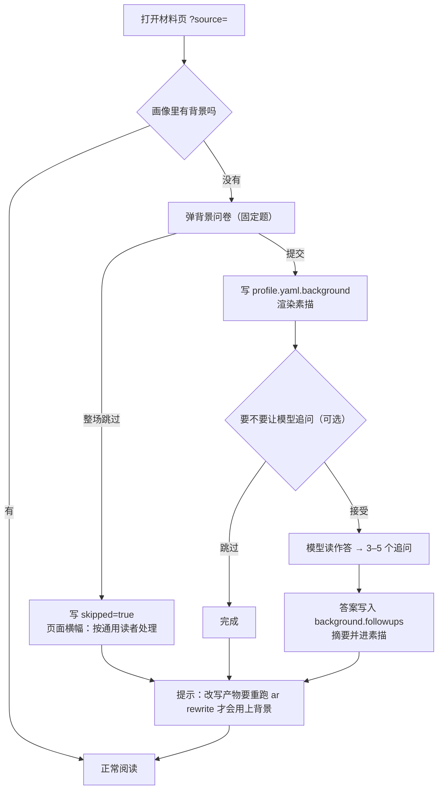

# adaptive-reader · 读前背景问卷（前置测试）· 实施方案

> **状态：已批准（2026-10-08，用户拍板 §2 的 4 个决策点）。** 本文件是执行子代理的契约，
> 与 `PLAN-skeleton.md` 同级效力；两者冲突时以本文件为准（本文件更新更晚），并把冲突回报给协调者。
> 上位设计见 [DESIGN.md](DESIGN.md)；本方案只覆盖「读前背景问卷」这一层，不动骨架既有契约。

## 0. 一句话与定位

读任一材料之前，用一套**固定的背景题**（受教育程度 / 高中六选三 / 大学学科门类 / 自报特长领域）
建立读者画像；提交后可让**模型按你的作答追问 3–5 个细节**（可跳过）。答案存进画像，渲染成一段
**逐字稳定**的「读者素描」注入改写提示词，让改写据此决定哪段展开、哪段保持。

**与原设计的关系**：`DESIGN.md` §3.1 / §5 里那个「读前短测验」是**按本篇材料的概念清单出题**
（自评 → 辨识 → 复述三层，产物 `quiz.json`）。本次做的是**跨材料的通用背景问卷**，不读材料也能答、
答一次长期复用。两者并列不冲突：按材料出题那一层留待后续（`DESIGN.md` §10.4 第 2 项的后半段）。

## 1. 范围

**做**

1. 固定问卷：题目、选项、条件题规则、答案校验、问卷版本号。
2. 可选模型追问：模型读完读者对固定题的**作答**后追问细节（不依赖材料），可整场跳过。
3. 答案落画像：`profiles/<reader>/profile.yaml` 新增顶层键 `background`。
4. 「读者素描」注入 `rewrite` 提示词（提示词升版 `rewrite-v3`，回归基线随之更新）。
5. 前端：首次打开材料时自动弹问卷，可整场跳过，跳过与降级都有可见说明。
6. HTTP 三个端点（见 §8），旧键一个不改。
7. 测试与文档同步：`README.md` / `DESIGN.md` / `PLAN-skeleton.md` / 工作区根 `AGENTS.md`。

**不做**（本次明确划线）

- 按材料概念出辨识题 / 复述题（`DESIGN.md` §5 三层设计的后半段）。
- 行为信号回流、局部重跑、压缩动作、配图、网页 / PDF 入口、跨材料概念复用。
- 讲解链路（`/api/explain`）的背景注入——讲解卡片依据仍是概念状态（列在 §14 决策点）。
- CLI 新子命令：避免动 `tests/test_cli.py:15/:18`、`cli.py:1-15`、`README.md:39-45`、
  `PLAN-skeleton.md:63-69` 这一整套冻结面（**2026-10-13 更新**：只读的 `ar tools` 后来作为第 6 个子命令
  进了这套冻结面，见 [PLAN-skeleton.md](PLAN-skeleton.md) §4 与 [PLAN-llm-tools.md](PLAN-llm-tools.md) §3.6；
  本方案自己仍然不加子命令）。命令行入口用「手改 `profile.yaml`」代替。
- 多人账号；脚手架阶段仍只有 `local-default` 一个读者。

## 2. 已拍板（2026-10-08）

| # | 决策点 | 结论 |
|---|---|---|
| 1 | 题目清单 | **六个维度全做**：学历 / 六选三 / 学科门类+专业 / 自报领域 / 常读材料类型 / 遇到不懂时希望怎么讲，全部落进 `version: 1`（见 §3） |
| 2 | 背景算不算「有画像」 | **算**：背景非空即 `profile_used: true`，`profile_note` 写明「仅背景，无概念自评」 |
| 3 | 每段依据能不能写背景 | **只在 `why.note` 里说明**：不动 `changes.json` 契约、`why.profile` 的元素格式不变、前端 chips 不改 |
| 4 | 模型追问问几次、问几个 | **与固定问卷同一批做**：首次问卷后问一次、3–5 个、每题可空、可整场跳过 |

## 3. 固定问卷 v1（题目清单）

答案里的枚举值一律用**英文稳定串**（与 `concepts[].state` 同惯例），中文只在展示层出现；
问卷版本 `version: 1`，题目或选项一变就升版（老答案照样可读，只在页面上提示「问卷已更新」）。

| 题号 | 维度 | 形式 | 选项 / 取值 | 出现条件 |
|---|---|---|---|---|
| Q1 | 受教育程度 | 单选 | `junior_or_below` 初中及以下 / `high_school` 高中（含中专、职高）/ `college` 大专 / `undergraduate` 本科 / `master` 硕士 / `doctor` 博士 / `prefer_not` 不想说 | 总是 |
| Q2 | 高中选考科目（六选三） | 多选，**正好 3 项** | `physics` 物理 / `chemistry` 化学 / `biology` 生物 / `politics` 政治 / `history` 历史 / `geography` 地理；另有 `not_applicable` 没上过高中 / `forgotten` 记不清（与多选互斥） | Q1 ∈ {高中, 大专, 本科, 硕士, 博士} |
| Q3a | 大学学科门类 | 单选 | 哲学 / 经济学 / 法学 / 教育学 / 文学 / 历史学 / 理学 / 工学 / 农学 / 医学 / 管理学 / 艺术学 / 军事学 / 交叉学科 / `none` 没读大学 / `unsure` 不确定 | Q1 ∈ {大专, 本科, 硕士, 博士} |
| Q3b | 具体专业 | 单行自由文本，可空 | 例：国际经济与贸易 | 同 Q3a，且 Q3a ≠ 没读大学 |
| Q4 | 自报特长 / 熟悉领域 | 多选 + 自由填写 | 经济与金融 / 数学与统计 / 编程与计算机 / 自然科学 / 医学与健康 / 历史与人文 / 哲学与思想 / 法律 / 工程技术 / 艺术与设计 / 语言与文学 / 教育心理 / `none` 都没有 | 总是 |
| Q4b | 补充说明 | 多行自由文本，可空 | 例：读过《资本论》第一卷前两章 | 总是 |
| Q5 | 常读材料类型 | 多选 | `textbook` 教材课本 / `papers` 学术论文 / `popular_news` 通俗读物与新闻评论 / `tech_docs` 技术文档 / `reports` 报告与公文 / `fiction` 小说文学 / `rarely` 很少读长文（与多选互斥） | 总是 |
| Q6 | 遇到看不懂时更希望怎么讲 | 单选 | `conclusion_first` 直接讲结论 / `prerequisites` 补前置概念 / `example` 举个例子 / `simpler_wording` 换成更简单的话 / `unsure` 说不清 | 总是 |

> **英文枚举值的唯一来源**是 `src/ar/survey.py` 的题目定义（`GET /api/survey` 原样返回给前端渲染，
> 含 `questions[].field` 与 `options[].value`）。**前端不得自建第二份题表**——2026-10-08 实施时
> 两路各自发明过字段名（前端 `materials` / `explanation` / `history_studies` / `military` /
> `education_psych`，与后端对不上，提交会 400），本条就是为了不再犯。表内的英文值仅供阅读。

**条件题规则**（前端按规则即时显隐，后端独立复算同一规则，不信任前端）：

- 条件不满足时，对应字段**不写进画像**（不是写 null），避免「没问过」与「问了没答」混在一起。
- Q2 选 `not_applicable` / `forgotten` 时不再要求正好 3 项。
- Q3a 选 `none` / `unsure` 时 Q3b 不出现。

**校验**（后端，非法即 `InputError` → HTTP 400）：枚举闭合、Q2 除豁免值外必须正好 3 项、
Q4 自由文本与 Q4b 各自长度上限（暂定 Q4b ≤ 200 字符、Q3b ≤ 60 字符，超出截断并标 `truncated`）。


## 4. 模型追问（可选）

- **输入**：固定题作答（结构化）+ 当前素描草稿。**不读材料正文**（用户已定：追问看作答，不看材料）。
- **输出**：3–5 个问题，每个含 `q`（问题文本，如「你说熟悉经济金融——读过《资本论》原文吗？」）
  与 `hint`（一句话提示读者可以怎么答）。
- **提交**：读者逐题作答或留空；答案以 `{q, a, at}` 追加进 `background.followups[]`，
  并把摘要并进素描文本（§5），否则追问等于白问。
- **触发**：只在问卷首次提交后由页面上一个按钮触发（「让模型追问几个细节（可选）」）；
  题目不予重复追问，除非读者手动点「重新追问」（本次不做，列 §14）。
- **失败与超时**：返回 200 + `degraded` 说明（照 `/api/explain` 的既有惯例），
  **固定题答案不受影响、照常保存**；模型未配置时页面隐藏该按钮并写明原因。
- **成本可见**：追问的 token 账记进 `profiles/<reader>/survey.json`（§6.2）与响应体 `usage`。
- **提示词**：新增 `survey-v1`（`src/ar/prompts.py` 里与 `concepts-v2` / `rewrite-v2` / `explain-v2` 并列），
  遵循既有的前缀缓存纪律：固定块（角色、输出 JSON 形状、规则）在前，作答内容在末尾。

## 5. 读者素描（进提示词的文本形态）

由 `src/ar/survey.py`（新模块）把 `background` 渲染成一段中文文本，**同画像必得同文本**：

```
读者背景：本科学历；大学为经济学门类（专业：国际经济与贸易）；高中选考物理、化学、生物；
自报熟悉领域：经济与金融、编程与计算机；补充：读过《资本论》第一卷前两章。
```

渲染纪律（这三条直接决定前缀缓存与回归基线能不能守住）：

1. **逐字稳定**：字段顺序固定（学历 → 学科门类 → 专业 → 六选三 → 自报领域 → 常读材料 → 偏好讲法 → 补充说明 → 追问摘要），
   空项措辞固定（`未提供：高中选考科目`），**不含时间戳、不含随机数、不含段号**。
2. **有长度上限**：整段 ≤ 400 字符；超长时按**固定顺序整项丢弃**（先 Q5 常读材料 → 再 Q6 偏好讲法 →
   再 Q2 六选三 → 再 Q4b 补充说明），尾部写「…（已省略 N 项）」；
   不参与丢弃的核心项有四个：**学历（Q1）/ 大学学科门类（Q3a，专业跟在它后面合成一项）/
   专业（Q3b，只在门类缺失或为「没读大学」「不确定」时独立成项）/ 自报熟悉领域（Q4）**，
   另加**追问摘要**（按下面的整条规则处理）；
   手改画像里只有专业、没有有效门类时，那个「专业」同样算核心项，
   这样接口落盘与手改画像两条路径的行为一致。
   追问摘要另按**整条**处理：超预算时从最后一条往前整条丢，并写「…（追问摘要省略 N 条）」——
   **不许按字符硬截、不许截半句**（截出来的半句会让「同画像同文本」失效）。
   丢弃集合永远是候选顺序的**前缀**（装不下才一项一项往下丢）；若连核心项自己都超限（选项文本被大幅
   写长时才可能发生），**抛错**，不静默截断。
3. **两种缺省措辞分开**：完全没答 → 模板固定行 `读者背景：` 之后只写 `未提供（读者跳过了背景问卷）`
   （**前缀只出现一次**——2026-10-08 的实现里一度连着出现两行「读者背景：」）；
   答了一部分 → 逐项写「未提供：X」，空项也在 §5.1 的位次上（或统一收在尾部，但内部次序照 §5.1）。
   这样「跳过」与「没答完」在产物里分得开。

## 6. 数据字段

### 6.1 画像新增顶层键 `background`（`profiles/<reader>/profile.yaml`）

```yaml
reader: local-default
background:
  version: 1
  answered_at: "2026-10-08T16:40:00+08:00"
  skipped: false                 # 整场跳过时 true，其余字段可缺
  education: undergraduate
  high_school_electives: [physics, chemistry, biology]
  university:
    discipline: economics
    major: "国际经济与贸易"
  strengths: [economics_finance, programming_computer]
  strengths_note: "读过《资本论》第一卷前两章"
  followups:
    - { q: "……", a: "……", at: "2026-10-08T16:45:00+08:00" }
concepts: {}
preferences: []
overrides: []
```

**形状**：`background.university.discipline` / `background.university.major` 是**嵌套**的（不是扁平的
`discipline` / `major`）。2026-10-08 实施时后端曾把它拉平，已按本节改回。

⚠ **必改点**：`src/ar/profile.py` 的 `_normalize`（`profile.py:50-66`）是**白名单重建**，
新顶层键会被**静默丢弃**（不报错、不进 `degraded`）；`apply_rating` 入口还会再归一一次
（`profile.py:106`）。必须同时改：`default_profile` 骨架（`profile.py:45-47`）、白名单、
模块文档（`profile.py:1-16` 写着「四个顶层键」「只有自评一个写入来源」）、`__all__`（`profile.py:29-37`）。

兼容：老画像没有 `background` 键 → 视为「未提供」，不报错、不写盘（回答前不产生副作用）。

### 6.2 记录文件 `profiles/<reader>/survey.json`（不进版本库）

问卷版本、每题原值、追问的原始问答、追问调用的元数据（`model` / `prompt_version` / `usage`）。
**不参与缓存指纹**——两处缓存失效信号都只看 `profile.yaml`（后端 `src/ar/cache.py:37-48` 的
`(路径, 字节数, mtime_ns)`；前端 `web/js/api.js:94-99` 的响应摘要）。所以答案**必须同时写进
`profile.yaml`**，否则讲解缓存与前端都会用旧指纹继续命中。

### 6.3 改写产物 `meta` 追加（不破坏旧键）

| 字段 | 含义 |
|---|---|
| `background_used` | `true` / `false`：这次改写是否拿到了非空素描 |
| `background_fingerprint` | 素描文本的 8 位哈希，用来判断「这次用的是哪版背景」 |
| `profile_note` | 补充「仅背景，无概念自评」这类说明（文案见 §2 决策点 2） |

落点：`src/ar/rewrite.py:1074/:1098`（`decisions.json` 与 `changes.json` 的 `meta` 写入处）。

### 6.4 `profile_used` 的语义（第二个必改点）

现状：`profile_used` 只由 `concepts` / `overrides` 决定（`src/ar/rewrite.py:941`）。
**只有背景、没有概念自评**时，今天会被判成「无画像」，并触发三处连带效果：
`rewrite.py:948-953` 往 `degraded` 写「无画像模式」、`rewrite.py:979-989` 把每段的
`why.profile` 覆盖成「难度 N（无画像）」或空数组、产物 `meta.profile_used=false`。
也就是说：**背景进了提示词、产物却声称没用画像**——这是本方案最容易出的「看起来做了其实没做」。

按 §2 拍板 2：背景非空即 `profile_used: true`，`profile_note` 区分三种情况
（只有概念 / 只有背景 / 两者都有）；「完全空画像」仍走既有降级路径不变。

## 7. 流程



关键取舍：**弹问卷放在正文渲染之后**（`web/js/main.js:921-924` 之后），不挡阅读；
正文渲染失败时问卷也不弹（先保证能读）。「首次打开」的判定信号取**服务端画像**
（不是 `localStorage`）——`localStorage` 会与真实画像不一致，而且前端现有唯一的键
`ar.settings.v1`（`web/js/settings.js:22`、`web/index.html:10-47`）另有用处，不能复用。

## 8. HTTP 契约（追加，不改旧键）

路由要排在兜底路由 `server.py:279` 的 `/api/{rest:path}` **之前**。

| 方法 与 路径 | 请求 | 响应 |
|---|---|---|
| `GET /api/survey` | — | `{ version, questions[], answers, skipped, degraded[] }`；`answers` 为当前 `background`（无则 `null`）。题目由后端给，前端不硬编码 |
| `POST /api/survey` | `{ answers?, skipped?, followups? }` | `{ ok, background, sketch, degraded[] }`；校验失败 400（`InputError` → `server.py:299-308` 的既有转换） |
| `POST /api/survey/followup` | `{ }`（用画像里已存的作答） | `{ questions[{q,hint}], usage?, model?, prompt_version?, degraded }`；失败仍 200 + `degraded` 说明（照 `/api/explain` 惯例，`server.py:15-28`） |

读者 id 取自应用级配置（`server.py:113`），本次**不加**按请求传读者的入口。

提交体两种写法后端都收：`{answers: {...}}`（**前端统一用这种**）与把作答字段直接铺在顶层（兼容）。
字段名与枚举值以 `src/ar/survey.py` 的题目定义为唯一来源，照 `questions[].field` 与
`options[].value` 原样提交，不许自建别名。

**提交体不带 `version`**：后端按只读白名单校验作答槽位，多余键一律 400。问卷版本由服务端记进
`background.version`。`GET /api/survey` 顶层给两个值——`version`（当前问卷版本）与
`answered_version`（读者上次作答时的版本，没答过 / 空画像 / 整场跳过时为 `null`）；
页面的「问卷已更新」提示比较这两个值，**不许**把版本存进浏览器本地。

`questions[]` 除契约键外还给前端渲染用的**等价别名**（`qid` / `field` / `label` / `when` /
`alsoWhen` / `exactly` / `atLeast` / `exclusive` / `maxLength` / `placeholder` / `hint`）。
**别名必须与权威 `requires` 等价**，任何一条不等价都算服务端的 bug——2026-10-08 踩过：
`not_in` 多值只取了第一个，导致 Q3a 选「不确定」时 Q3b 仍会显示，读者填的专业随后被丢弃。

## 9. 前端

新增 `web/js/survey.js`（问卷界面）、`web/css/` 里追加样式、`web/index.html` 加容器宿主。
**界面包含两块**：固定问卷（六题，条件题联动）与提交成功后的**模型追问入口**（§4：一个按钮、
3–5 个问题、可整场跳过、失败可见降级）——只做前者等于没做完。

- **形态**：项目里**没有**任何模态 / 遮罩 / `<dialog>` / `<form>` 先例（已核：`web/` 与 `reader.css`
  全量类名都没有）。因此这是新建组件：居中卡片 + 遮罩，可键盘操作，`Esc` 与「跳过」同效（都算跳过），
  关闭后焦点回到正文。第一版**不做**焦点陷阱等重型交互，但必须：不挡滚动恢复、不吞正文点击、
  关闭后不留残影。
- **复用**：视觉与交互参考设置面板（`web/js/settings.js:242-275` 的单选行、`settings.js:281-330`
  的面板骨架、`settings.js:357-362` 的开合）与讲解卡片的三段布局（`web/js/view.js:124-229`）。
- **显隐规则**：按 §3 的条件题规则即时联动；选「初中及以下」时 Q2/Q3 自动收起。
- **提交后**：横幅说明「背景已保存」+「改写产物要重跑 `ar rewrite` 才会用上」（前端不触发重跑）。
- **跳过**：写 `skipped: true`，横幅「未提供背景，按通用读者处理」（可见降级，不许静默）。
- **夹具模式**（`?fixture=`）：`web/js/api.js:105-106` 在夹具模式下不请求画像，因此**默认不弹问卷**；
  为让无头测试能覆盖问卷界面，支持显式 `?survey=1` 打开表单，提交后显示「夹具模式不保存」说明。
- **`__arDebug`**：问卷的开启 / 提交 / 跳过事件写进既有的调试标志（`web/index.html:115-164` 的字段集，
  命名与 `web/README.md:74-96` 的记录方式保持一致），供无头用例等待，不靠 sleep。

## 10. 提示词改动与缓存纪律

- 插入点：`src/ar/prompts.py` 的 `REWRITE_USER_TEMPLATE` **固定块**（现第 122–150 行区间），
  紧跟现有 `{profile_block}` 之后新增一行 `读者背景：{background_block}`。
  该区间属批间共享前缀（system 202 字符 + user 第 122–150 行），素描逐字稳定 ⇒ 共享前缀继续成立，
  且**首个差异字符仍是第 151 行的段号位**（`tests/test_rewrite.py:397-438` 的守卫断言应继续通过，
  阈值只会变长不会变短）。
- **绝不允许**把素描写进第 151–153 行区间，也绝不允许素描随批次变化（含段号 / 本批段 id）。
- 素描为空时写固定文案（§5 两种缺省措辞），保证模板逐字稳定。
- 固定块里另有**一条规则**（规则 8）要求把读者背景当作展开/保持的依据之一，并明确：依据写进
  `why.note`、**不写进 `why.profile`**、正文里不提读者本人（§2 拍板 3）。规则 5 的「依据来自概念清单
  与读者画像」同时放宽为「…、读者画像与读者背景」，否则字面上把背景排除在外。
- 提示词版本 → `rewrite-v3`（回归基线字段，`concepts.json` / `decisions.json` / `changes.json`
  的 `meta.prompt_version`）。追问提示词 → `survey-v1`。
- **不承诺省钱**：素描约 100–300 字符，离网关「共享前缀 ≥ 约 2048 token 才算命中」的门槛
  （`README.md:430-442`、`DESIGN.md:347`）还差得远，同一轮 6 批仍互不命中。本层的目的只是让改写
  更贴读者，不是降本。

## 11. 降级路径（逐条，必须可见）

| 情况 | 行为 |
|---|---|
| 整场跳过问卷 | 写 `skipped: true`；页面横幅「未提供背景，按通用读者处理」；素描取「未提供」分支 |
| 单题跳过 / 条件题没出现 | 该字段不写；素描逐项写「未提供：X」，**不猜** |
| 模型追问失败 / 超时 / 未配置 | 200 + `degraded` 说明；固定题答案照常保存；未配置时页面不给按钮入口 |
| 夹具模式 | 默认不弹；`?survey=1` 可看可填，提交后写明「夹具模式不保存」 |
| 画像文件不存在 | 已有降级路径（`profile.py:69-78` 的可见说明），首次提交时创建文件 |
| 老画像没有 `background` | 视为「未提供」，不报错、不写盘 |
| 问卷版本不一致 | 页面上提示「问卷已更新，可重新填」，不强制、不丢旧答案 |
| 答案非法（枚举外 / 六选三不是 3 项） | `InputError` → 400，并在响应里点名哪一题 |
| 自由文本超长 | 截断并在响应与 `survey.json` 标记 `truncated`（降级可见，不许静默截断） |
| 已答过之后又整场跳过 | 只记 `skipped: true`，**保留已有作答**，响应里写明「已有背景保持不变」（静默删除读者填过的东西是最危险的一类行为；清空要另有明确动作，本次不做） |

## 12. 验收标准

**后端（新增 `tests/test_survey.py`）**

1. 题目定义自洽：枚举闭合、条件题规则可复算、版本号存在。
2. 素描渲染：同画像同文本（逐字）、空项措辞固定、跳过与部分作答两种措辞分得开、≤400 字符截断与丢弃顺序（§5.2）。
3. 画像读写：写入后读回形状正确；`version` 保留；老画像（无 `background`）读取不报错。
4. 校验：枚举外、六选三给 4 项、超长文本 → 各自的拒绝 / 截断行为。
5. 追问端点：模型失败 → 200 + `degraded`，且**固定题答案不丢**。
6. 提示词布局：照 `tests/test_rewrite.py:397-438` 的写法，断言素描进固定块、首个差异字符
   仍在段号位、固定块里无时间戳、规则措辞未变。
7. `profile_used` / `background_used` 的**四种组合**（只有背景 / 只有概念 / 都有 / 都没有）逐一断言，
   含`why.profile` 不被误覆盖。
8. 缓存失效：改 `profile.yaml` 后讲解缓存失效（既有用例已覆盖）+ 背景变则 `background_fingerprint` 变。
9. `tests/test_profile.py:99` 的键集断言同步到新键集；`:72` 的往返相等继续通过。

**前端（新增 `tests/web/test_survey_ui.py`）**

1. 表单渲染 + 条件题联动（选「初中及以下」时大学题消失）。
2. 提交 → 可见成功说明 + 「要重跑改写」提示；跳过 → 可见横幅。
3. `?survey=1` 夹具模式下可填、提交后写明「不保存」。
4. `__arDebug` 标志与就绪等待沿用现有纪律；每个用例的 autouse「无 JS 报错」断言必须通过
   （`tests/web/conftest.py:151-156`）。
5. 本机 Edge、不下载内核（`tests/web/conftest.py:117-137`）；真服务联调用例默认 skip，
   计费开关 `AR_E2E_BILLABLE=1` 才跑。

**人工验收**

填一份背景 → 重跑 `ar rewrite capital-v1-ch01 --reader local-default` → 检查产物
`meta.background_used` / `background_fingerprint`、每段依据是否体现背景（`why.note`），
并把 token 账（`meta.usage` / `batch_usage`）贴进 `README.md` 的实跑记录。旧产物的指纹保留，
不得覆盖成新值。

> **验收状态（2026-10-13）：已完成。** 背景是 2026-10-09 填的，素描 `c9037bb4`（96 字符，
> 未触发 400 字符上限的丢弃）；同一份提示词整篇跑了两遍——第 1 遍坏（`ar check` 退出码 4、
> `rewritten.md` 27 段）、丢掉后整篇重跑（局部重跑尚未实现），第 2 遍全绿（`ar check` 退出码 0、
> 25 段、`mismatches: []`、重跑命中前缀缓存 96%）。数字与逐批明细见 `README.md` §2.1.1；
> 素描注入后的模型措辞问题（`why.note` 自称「画像为空」）见 `README.md` §8 第 19 条。

## 13. 影响面（文件级改动清单）

| 文件 | 改动 |
|---|---|
| `src/ar/survey.py` | **新建**：题目定义、答案校验、素描渲染、追问调用 |
| `src/ar/profile.py` | 骨架 + 白名单加 `background`；模块文档与 `__all__` 同步 |
| `src/ar/prompts.py` | 追问提示词 `survey-v1`；`rewrite` 模板加 `{background_block}`；升 `rewrite-v3` |
| `src/ar/rewrite.py` | 素描进 context（`_format_profile_block` 旁）；`profile_used` / `profile_note` / `why.profile` 逻辑；产物 meta 追加两字段 |
| `src/ar/server.py` | 三个新端点（排在兜底路由前） |
| `web/index.html` `web/css/reader.css` `web/js/survey.js`（新）`web/js/api.js` `web/js/main.js` | 问卷界面、取数、挂接、调试标志 |
| `web/README.md` | 文件清单、接口契约、`__arDebug` 字段 |
| `tests/test_survey.py`（新）`tests/test_profile.py` `tests/test_rewrite.py` `tests/test_server.py` `tests/web/test_survey_ui.py`（新） | 见 §12 |
| `profiles/local-default/profile.yaml` | 注释同步。**准确表述**（2026-10-13 更正）：`profiles/` 整目录在 `.gitignore` 里、`git ls-files profiles` 为空，所以这份画像与 `data/` 一样只是**开发机盘上的运行产物**，**版本库里没有它的模板**；要不要把一份脱敏骨架纳入版本控制当模板 **待定**（不在本轮范围） |
| `README.md` `DESIGN.md` `PLAN-skeleton.md` `<工作区>\AGENTS.md` | 状态表、「未实现」清单、§4.3 画像、§5 交互、§10.2/§10.4、测试计数。**准确表述**（2026-10-13 更正）：工作区根 `AGENTS.md` 的索引行自 2026-10-12 起只有「目录 + 一句话作用 + 详见 README」，本项目的状态细节已迁进 `README.md` 的「状态快照」；**是否把状态搬回索引行待定**（`DESIGN.md` §11 已同步为同一口径） |

## 14. 风险与后续

- **最大风险**：背景进了提示词、产物却说「无画像」（§6.4）——验收标准第 7 条专门守它。
- **第二大风险**：画像新字段被白名单静默丢弃（§6.1）——第 3 条验收守它。
- 改写决策会变，**旧产物与新产物不可直接比**：`background_fingerprint` 是唯一的对照依据。
- 讲解链路不注入背景：读者填了背景，讲解卡片仍只按概念状态讲（按 §2 拍板本次不做，后续可扩）。
- 本次不做「按材料出辨识题」；`DESIGN.md` §3.1 的 `buildQuiz` / `applyAnswers` / `quiz.json`
  接口留给那一层，本方案用 `survey` 命名以免与之混淆。
